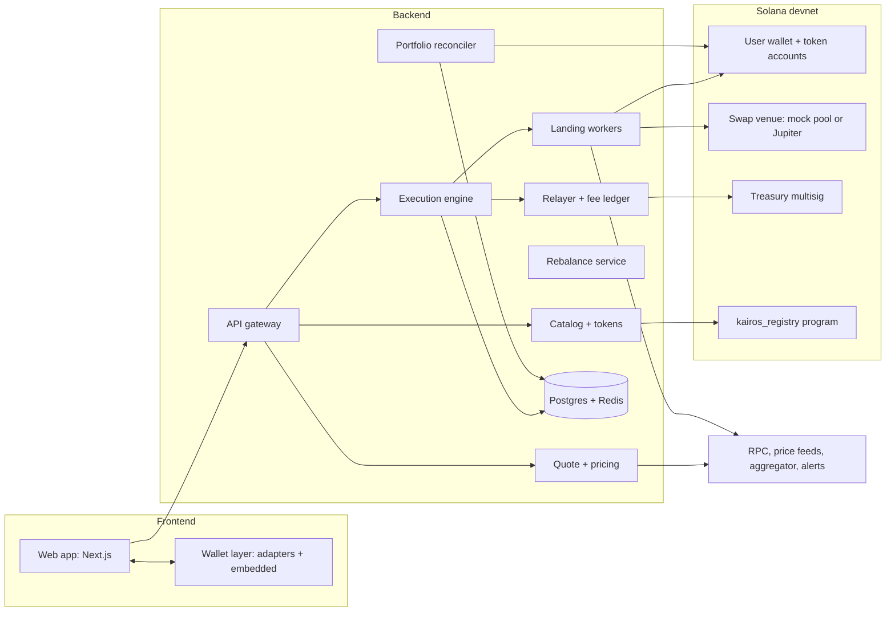
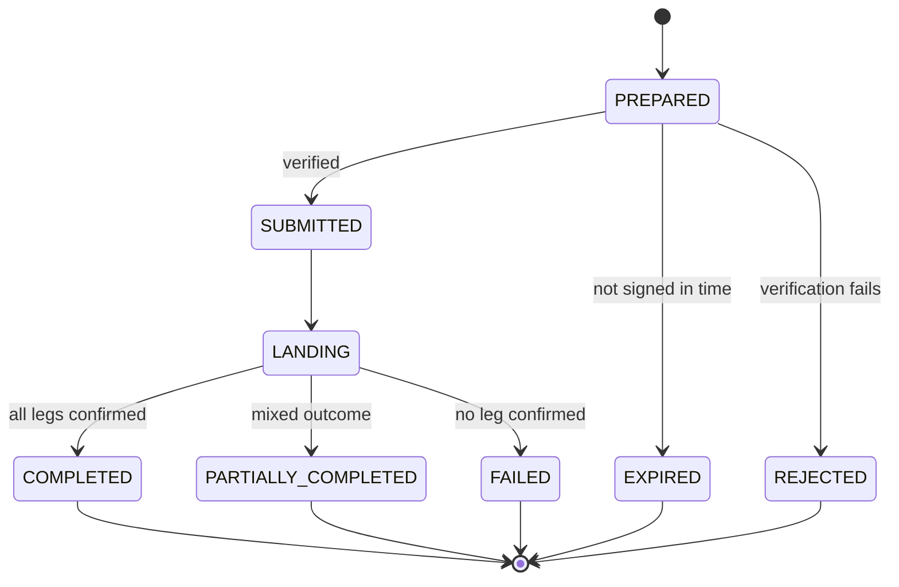
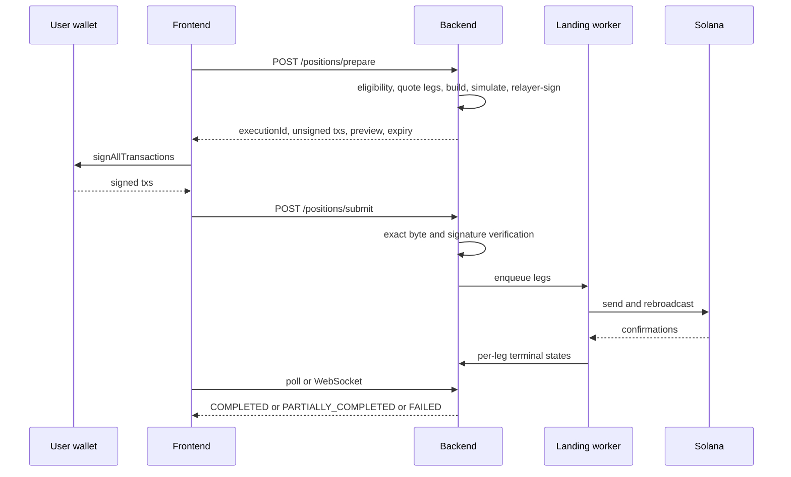

# Kairos — Full Product & System PRD (Frontend + Backend + Solana)

**Product:** Non-custodial, narrative-basket investing on Solana **Version:** v3.0 · Oct 7, 2026 · supersedes v1 and v2 **Target deployment:** Solana **devnet** (final deliverable). Mainnet is a later, separate release. **Chain scope:** Solana only **Naming:** "Kairos" is a working name. Original design informed by the category; no third-party branding or copy is reused. **Tags:** `[HYPOTHESIS]` = unratified number · `[VERIFY]` = re-check at build time · `[COUNSEL]` = needs legal advice

---

## 0. What changed in v3

| # | Change | Why |
| --- | --- | --- |
| 1 | **No blockhash substitution after the user signs.** Expiry before landing means the leg fails definitively and the user re-prepares | A user signature covers the whole message including the blockhash; changing it invalidates the signature |
| 2 | **Fee is a USDC transfer inside each leg's own transaction** (per-leg, atomic with that leg's swap) | A failed leg charges no fee. One mechanism, USDC-denominated, consistent math |
| 3 | **Corrected worked examples** with exact integer math (§6.6) | v2 examples contained errors and a drafting artifact |
| 4 | **Frontend PRD added** (§4) | Full end-to-end scope |
| 5 | **Solana layer section added** (§7), incl. optional on-chain `kairos_registry` program | Solana-native transparency without custody |
| 6 | **Devnet strategy restored** (§14) | Devnet is the final deliverable |
| 7 | **"Signs once" replaced** by "one approval prompt where the wallet supports `signAllTransactions`; otherwise one prompt per asset" | Multi-leg is non-atomic |
| 8 | Accounting uses `finalized`; UI updates use `confirmed` (flagged provisional) | Resolves the reconciler-latency vs finality tension |
| 9 | Compliance and launch gates trimmed to what devnet needs; mainnet gates moved to §13.2 | Scope fit |

---

## 1. Product overview

### 1.1 Vision

"Invest in what you believe." A user picks a themed basket (e.g. *Solana Infrastructure*, *AI Leaders*, *Stablecoin Yield*), enters a USDC amount, approves the transactions, and ends up holding the real underlying assets in their own wallet. No vault, no IOU token.

### 1.2 Goals

1. One guided flow from basket to holdings in under 60 seconds `[HYPOTHESIS]`.
2. Backend never holds user funds or keys. Every fund movement needs user authorization (except an explicitly opted-in, policy-scoped auto-rebalance).
3. Fee, expected receive amount, and slippage shown **before** signing.
4. Partial completion is a named, recoverable state, never hidden.
5. Curators publish immutable versioned baskets; funds move only when the user rebalances.
6. Honest performance: backtests labelled hypothetical with a stated method.

### 1.3 Non-goals (v1 / devnet)

Custody, pooled vaults, basket share tokens · leverage, perps, lending legs · prediction-market legs · fiat on/off-ramp · prompt-to-basket AI · any chain other than Solana · mainnet launch and real funds · native mobile apps.

### 1.4 Users and actors

| Actor | May do | Must not do |
| --- | --- | --- |
| Visitor | Browse catalog, backtests | Sign or see a portfolio |
| Investor (external wallet) | Invest, rebalance, close, withdraw | Have keys held by Kairos |
| Investor (embedded wallet) | Same, plus opt in to policy-scoped auto-rebalance | Authorize anything outside the policy |
| Curator | Draft baskets, propose versions | Publish alone; touch positions |
| Admin | Approve publishes, kill switch, config | Bypass 2-person publish |
| Support | Read executions and portfolio state | Move funds or edit positions |
| Backend / relayer | Build and verify txs, land signed txs, pay gas | Move funds without a user signature |

### 1.5 Success metrics

North star: **weekly invested USDC reaching real on-chain positions** (devnet: test USDC). Breach counters that must read **zero**: fee double-charge, tampered tx accepted, idempotency collision, unauthorized fund move.

| Metric | Target `[HYPOTHESIS]` |
| --- | --- |
| Prepare latency p95 (≤6 legs) | ≤ 3 s |
| Leg landing success (7 d) | ≥ 99% |
| Partial-completion rate | ≤ 3% |
| Reconciliation lag p95 | ≤ 30 s |
| Support tickets per 100 executions | ≤ 3 |

---

## 2. Scope (MoSCoW)

| Priority | Items |
| --- | --- |
| **Must** | Catalog + immutable versions · prepare/sign/submit engine with byte verification · multi-leg buys with partial state · portfolio from on-chain balances · close and withdraw · gas relayer · per-leg fee accounting · kill switch · notification outbox · web app (browse, invest, portfolio, execution status) |
| **Should** | Manual rebalance · backtests · auto-rebalance with policy · curator console with 2-person publish · `kairos_registry` on-chain version registry |
| **Could** | Labs / UGC · multi-aggregator routing · points |
| **Won't (now)** | Custody · leverage · prediction markets · fiat · AI baskets · mobile apps |

---

## 3. System architecture



### 3.1 Layers

| Layer | Responsibility |
| --- | --- |
| **Frontend** | Presentation, wallet interaction, human-readable transaction preview, live status |
| **Backend** | Quotes, building unsigned transactions, verification, landing, indexing, versioning, notifications |
| **Solana** | Source of truth for holdings. Programs used: SPL Token, Associated Token Account, Compute Budget, Memo, swap venue. Optional `kairos_registry` for version hashes |

### 3.2 Authority matrix

| Party | Authority |
| --- | --- |
| User | Signs their own transactions; keys never leave their wallet/provider |
| Backend | Builds unsigned txs, verifies signed bytes, lands, indexes. Cannot move user funds |
| Relayer | Fee payer and ATA-rent payer only. Pre-signs only transactions that passed simulation and allowlist checks |
| Curator / Admin | Publish via 2-person approval; kill switch. No access to positions |
| Treasury multisig | Receives fees; no authority over user accounts |

### 3.3 Tech stack

| Layer | Choice |
| --- | --- |
| Frontend | Next.js + TypeScript, Solana Wallet Standard adapters, TanStack Query, Tailwind |
| Backend | Node + TypeScript (Fastify), Postgres + Drizzle, Redis, BullMQ |
| Solana | `@solana/kit`; Anchor only for the optional registry program |
| Providers | Helius/Triton RPC (devnet endpoint) `[VERIFY]`, Jupiter + mock swap, Pyth `[VERIFY]`, Privy or Para `[VERIFY]` |
| Ops | OpenTelemetry, Prometheus/Grafana, Sentry, Terraform, GitHub Actions |

---

## 4. Frontend requirements

### 4.1 Pages

| Page | Content | Key behaviours |
| --- | --- | --- |
| Home / catalog | Basket grid, category filters, live prices, "devnet / test data" banner | Cached reads, skeleton loading |
| Basket detail | Thesis, composition table (mint, weight, live price), version history, backtest, risk tab | Switch between versions; shows "hypothetical performance" label |
| Invest panel | USDC input (min `[HYPOTHESIS]` 25), per-leg preview, fee, estimated receive, price impact, custody note, expiry countdown | Disabled until wallet connected and eligible; re-preview on expiry |
| Signing & status | Per-leg progress (pending, sent, confirmed, failed), signatures with explorer links | Survives refresh; resumes via `executionId` |
| Portfolio | Positions with live value, P&L, weights vs target, drift, "new version available" | Provisional marker while data is `confirmed` but not `finalized` |
| Position detail | Leg table, history, rebalance and close actions, auto-rebalance toggle | Shows policy disclosure before enabling |
| Rebalance preview | Sell/buy legs, fee, impact, version diff | Same signing flow as invest |
| Settings | Wallet, session, auto-rebalance policies, revoke | One-click revoke |
| Admin console (separate app) | Basket drafts, publish approval, kill switch, executions, relayer balance | SSO + 2FA, IP-restricted |

### 4.2 Wallet UX

- Connect: Wallet Standard adapters (Phantom, Solflare, Backpack) or embedded wallet (email, Google, X, Telegram).
- Auth: Sign-In With Solana (nonce + signature) for external wallets.
- Signing: request all leg transactions with `signAllTransactions` where supported (one approval prompt); otherwise sequential prompts with a progress indicator ("Approve 2 of 5").
- Before any signature the UI must render the transaction summary from backend data, not from raw bytes.
- On devnet, detect wrong network and prompt to switch.

### 4.3 State rendering

| Backend state | UI |
| --- | --- |
| `PREPARED` | Summary, countdown, "Approve" |
| `SUBMITTED` / `LANDING` | Per-leg spinners, disable resubmit |
| `COMPLETED` | Delta in portfolio, explorer links, fee charged |
| `PARTIALLY_COMPLETED` | Per-leg table; actions **Retry failed legs** and **Unwind landed legs** |
| `FAILED` | Reason, "nothing was charged", new prepare |
| `EXPIRED` | "Price expired. Please re-preview." |
| `REJECTED` | "Security check failed. Your signature was not used." |

### 4.4 Confirmation summary (verbatim structure)

```
You are investing:     100.500000 USDC
Fee (per asset):         0.201000 USDC (20 bps)
Estimated receive:      ~99.9 USDC of assets across 5 legs
Custody:                Assets go to your wallet. Kairos holds nothing.
Quote expires in:       00:58
```

### 4.5 Frontend NFRs

| ID | Requirement |
| --- | --- |
| FE-01 | LCP ≤ 2.5 s on catalog and basket pages (4G, mid-range phone) `[HYPOTHESIS]` |
| FE-02 | Fully usable at 360 px width; keyboard navigable; WCAG 2.1 AA; no state conveyed by color alone |
| FE-03 | No private keys or tokens in `localStorage`; session via httpOnly cookie or short-lived JWT |
| FE-04 | CSP with pinned origins; wallet and RPC origins allowlisted |
| FE-05 | All amounts displayed from integer minor units; no floating-point money math |
| FE-06 | Execution page recovers from refresh and tab close using `executionId` |

---

## 5. Backend services & functional requirements

| ID | Requirement | Pri | Acceptance (Given / When / Then) |
| --- | --- | --- | --- |
| FR-01 | Immutable basket versions | Must | Given a published version, when an edit is attempted, then a new version is created and old rows are unchanged |
| FR-02 | Weight validation | Must | `Σ weight_bps ≠ 10000` is rejected in service and by DB trigger |
| FR-03 | Token registry validation | Must | Unknown, denylisted, or illiquid mints cannot be published |
| FR-04 | Eligibility / region gate before quoting | Must | Blocked region gets `REGION_BLOCKED` with no aggregator call |
| FR-05 | Prepare builds unsigned txs | Must | Returns N txs, fee, expiry, `executionId`; stores `message_hash` per tx |
| FR-06 | Simulate before returning | Must | Any failed simulation fails the prepare and names the leg |
| FR-07 | Verify on submit | Must | Submitted message bytes must equal stored bytes; mismatch → `MESSAGE_TAMPERED`, nothing enqueued |
| FR-08 | Program and mint allowlist | Must | Any tx referencing an unlisted program or mint fails prepare |
| FR-09 | Idempotency | Must | Same `(wallet_id, key)` returns the same execution; different body → `IDEMPOTENCY_CONFLICT` |
| FR-10 | Landing with rebroadcast | Must | Signed tx rebroadcast until confirmed or its blockhash expires; then definitive terminal state |
| FR-11 | Partial completion state | Must | Mixed outcome → `PARTIALLY_COMPLETED` with per-leg signature/error |
| FR-12 | Per-leg fee, atomic with leg | Must | Fee transfer lives in the leg's tx; a failed leg charges no fee |
| FR-13 | Reconciliation | Must | On-chain change reflected in portfolio within 30 s p95; drift classified |
| FR-14 | External modification | Must | User sells/moves a leg outside Kairos → position `MODIFIED`, excluded from auto-rebalance |
| FR-15 | Close to USDC | Must | Reverse of invest using same pattern |
| FR-16 | Withdraw | Must | USDC transfer to any address, no lockup, no server delay |
| FR-17 | Kill switch | Must | Blocks new prepares within 60 s; never blocks close, unwind, withdraw |
| FR-18 | Notification outbox | Must | Exactly one notification per `(execution_id, event_type)`; retried until delivered |
| FR-19 | Audit log | Must | Every privileged action recorded with before/after |
| FR-20 | Support reproducibility | Must | From `execution_id`, every leg's amounts, hashes, signatures, errors, timestamps are visible |
| FR-21 | Manual rebalance | Should | Preview shows sell/buy legs, fee, impact, version diff before signing |
| FR-22 | Auto-rebalance with policy | Should | Runs only on new version publish, within mint/program allowlist, spend cap, slippage cap, expiry; revocation checked per leg |
| FR-23 | Backtests | Should | Hypothetical label, stated rebalance rule, non-backtestable legs excluded with reason |
| FR-24 | Version registry anchoring | Should | Publishing a version writes its legs hash to `kairos_registry`; UI can verify |
| FR-25 | Labs / UGC | Could | Allocations sum to 100%, registry-valid legs, moderation before promotion |

### 5.1 Service boundaries

Gateway/BFF · Auth · Catalog + tokens · Quotes · Execution · Landing workers · Portfolio reconciler · Rebalance · Fees + relayer · Notifications · Indexer · Admin.

---

## 6. Execution engine specification

### 6.1 Principle

Prepare → Sign → Submit for open, close, rebalance and auto-rebalance. Multi-leg is **not atomic**; each leg is its own transaction.

### 6.2 Leg transaction (v0 message, lookup tables if needed)

| Slot | Instruction | Signer |
| --- | --- | --- |
| 1–2 | Compute budget (limit, price) | relayer |
| 3 | `CreateIdempotent` ATA for output mint | relayer |
| 4 | Swap (aggregator route or mock pool) | user |
| 5 | USDC fee transfer `fee_i` to treasury ATA | user |
| 6 | Memo `kairos:{execution_id}:{leg_index}:{version_id}` | user |

Relayer is fee payer. After simulation and allowlist checks pass at prepare, the relayer **signs the message**. The user adds their signature. Any change to the message invalidates both signatures.

### 6.3 Prepare

1. Auth, eligibility, rate limit, idempotency check.
2. Convert amounts to integer minor units; split per §6.5.
3. Quote each leg individually; pin the route; compute `min_out_i` from slippage; reject if impact or staleness limits are exceeded.
4. Build each message with a fresh blockhash, simulate, relayer-sign.
5. Store `message_bytes_i`, `message_hash_i`, `last_valid_block_height_i`; return unsigned txs plus a human-readable preview.

### 6.4 Submit and landing

1. Match each submitted message bytes to the stored bytes (**exact equality, including blockhash**). Verify user signature, relayer signature, signer set, program allowlist.
2. Enqueue one landing job per leg.
3. Worker sends via RPC (optionally Jito), rebroadcasts every \~2 s, tracks confirmation.
4. **Definitive failure rule:** once the current block height exceeds `last_valid_block_height_i` and the signature is not found, the leg is `EXPIRED_UNLANDED`. A transaction cannot land after its blockhash expires, so no double-spend is possible. The user must re-prepare to retry.
5. On-chain error → `FAILED_ONCHAIN` (atomic: no funds moved; relayer paid the base fee).
6. Browser closing never cancels landing.

**Leg states:** `PENDING → SENT → CONFIRMED | FAILED_ONCHAIN | EXPIRED_UNLANDED | CANCELLED`.





### 6.5 Amount and fee math

All amounts are integer minor units (USDC has 6 decimals). Division floors toward zero. Rounding never reduces a leg below its floor; the remainder goes to the largest-weight leg.

**Invest.** `S` = gross USDC entered.

```
fee_total = floor(S × fee_bps / 10_000)
N         = S − fee_total
in_i      = floor(N × w_i / 10_000)        remainder of N → largest leg
fee_i     = floor(fee_total × w_i / 10_000) remainder of fee_total → largest leg
debit_i   = in_i + fee_i                    Σ debit_i = S
```

Legs with `in_i` below the dust threshold are rejected at prepare (the user must increase the amount). **Close:** fee per leg is `floor(quoted_out_i × fee_bps / 10_000)`, fixed at prepare, and `min_out_i` must cover it. **Rebalance:** fee per side on swap notional, same per-leg rule. Fee defaults: invest/close 20 bps, rebalance 10 bps per side, cap 75 bps `[HYPOTHESIS]`.

### 6.6 Worked examples (verified)

Basket weights `[4000, 3000, 1500, 1000, 500]` bps, fee 20 bps, `S = 50_030_001` (50.030001 USDC).

```
fee_total = floor(50_030_001 × 20 / 10_000) = 100_060
N         = 49_929_941
```

| Leg | w (bps) | floor(N·w/10000) | after remainder | fee_i | debit_i |
| --- | --- | --- | --- | --- | --- |
| 1 | 4000 | 19_971_976 | **19_971_977** (+1) | 40_024 | 20_012_001 |
| 2 | 3000 | 14_978_982 | 14_978_982 | 30_018 | 15_009_000 |
| 3 | 1500 | 7_489_491 | 7_489_491 | 15_009 | 7_504_500 |
| 4 | 1000 | 4_992_994 | 4_992_994 | 10_006 | 5_003_000 |
| 5 | 500 | 2_496_497 | 2_496_497 | 5_003 | 2_501_500 |
| **Σ** |  | 49_929_940 | **49_929_941** | **100_060** | **50_030_001** ✔ |

**Example A: all legs land.** User debited `50_030_001`; fee ledger `100_060`; `entry_usdc = 49_929_941`.

**Example B: legs 4 and 5 fail.**

- Debited: `20_012_001 + 15_009_000 + 7_504_500 = 42_525_501`
- Fee charged: `40_024 + 30_018 + 15_009 = 85_051`
- `entry_usdc` (landed inputs): `19_971_977 + 14_978_982 + 7_489_491 = 42_440_450`
- Unspent, still in user's wallet: `50_030_001 − 42_525_501 = 7_504_500` (= debits of legs 4 and 5)
- Check: `42_440_450 + 85_051 + 7_504_500 = 50_030_001` ✔

**Example C: all legs fail.** Debit 0, fee 0, state `FAILED`, no position.

### 6.7 Invariants

| ID | Invariant |
| --- | --- |
| X1 | Message bytes and hash are stored before an unsigned tx is returned and never modified |
| X2 | A submitted leg's bytes equal the stored bytes exactly |
| X3 | `(wallet_id, idempotency_key)` maps to at most one execution |
| X4 | `Σ fee_i` over confirmed legs equals `fee_charged` in the ledger; no leg counted twice |
| X5 | `Σ debit_i (confirmed) + unspent = intended` (conservation) |
| X6 | Every instruction targets an allowlisted program and an authorized mint |
| X7 | The relayer signs only after simulation and allowlist checks, and only as fee payer |
| X8 | `entry_usdc` equals the sum of confirmed leg inputs, never intent |
| X9 | Positions are projections of chain state; only chain-observed amounts update `position_legs` |
| X10 | Publishing a version moves zero user funds |
| X11 | Kill switch never blocks close, unwind or withdraw |
| X12 | An auto-rebalance leg lands only if the policy allows it at landing time |
| X13 | Published `basket_versions` and `basket_legs` rows are append-only |

### 6.8 Rebalance

- **Manual:** compute current vs target weights from on-chain balances; produce sell legs then buy legs; same prepare/sign/submit.
- **Auto (opt-in, off by default):** triggers only when a new basket version is published for opted-in positions, never on drift. Requires an embedded wallet and the provider's policy engine `[VERIFY]`. Policy: allowed mints and programs, per-rebalance USDC cap, slippage cap, max runs per day, expiry. Revocation is checked per leg at landing; already-landed legs cannot be reversed. A partial auto-rebalance leaves the position on the old version with a `REBALANCE_PARTIAL` flag and a notification.

### 6.9 Reconciliation

Positions are never authoritative in the database. Inputs: account subscriptions for tracked wallets plus a full scan every 60 s. UI updates use `confirmed` (flagged provisional); accounting, fee ledger and drift classification use `finalized`.

| Drift class | Meaning | Action |
| --- | --- | --- |
| `MATCHED` | Change attributable to a landed leg (via memo) | Update leg |
| `EXTERNAL_IN` | Inflow with no execution | Mark deposit, keep position |
| `EXTERNAL_OUT` | Outflow with no close | Position `MODIFIED` |
| `MISSING` | Token account closed or moved | Alert support |
| `UNAUTHORIZED` | Debit not matching any authorized execution | Sev-1, pause prepares |

---

## 7. Solana layer

### 7.1 On-chain components

| Component | Role | Notes |
| --- | --- | --- |
| User wallet + ATAs | Holds the real assets and USDC | The only place user value lives |
| SPL Token, ATA, Compute Budget, Memo | Standard programs used in every leg | Allowlisted |
| Swap venue | Jupiter on mainnet; **mock swap pool** on devnet | Behind `QuoteProvider` / `SwapBuilder` interfaces |
| Treasury multisig (2-of-3) | Receives USDC fees | Scheduled sweeps only |
| Relayer wallet | Fee payer and ATA rent payer | Capped SOL float `[HYPOTHESIS]` 20 SOL, pause below 5 SOL |
| `kairos_registry` (optional, Anchor) | Publishes basket version hashes | No funds, no custody |

### 7.2 `kairos_registry` (optional, recommended for devnet)

Purpose: let anyone verify that the composition shown in the app matches what the curator published.

| Account | Fields |
| --- | --- |
| `Registry` | authority (multisig), basket_count |
| `BasketVersion` (PDA: basket_id, version) | basket_id, version, legs_hash (sha256 of mints + weights), published_at, publisher |

Instructions: `publish_version` (authority only), `deprecate_version`. Entries are append-only. The frontend recomputes `legs_hash` from the displayed composition and compares it to the on-chain value (shown as a "verified on-chain" badge). No instruction touches user funds. Out of scope for the registry: swaps, custody, positions.

### 7.3 Devnet assets

Test USDC mint (you hold mint authority) · 8–12 test asset mints with realistic metadata · a mock swap pool or authority-controlled treasury swapping at oracle/seeded prices with configurable spread · seeded price feed (random-walk option) where Pyth devnet lacks a feed.

---

## 8. Data model (Postgres)

| Table | Key columns |
| --- | --- |
| `users` | id, email, auth_provider, region, status |
| `wallets` | id, user_id, address (unique), type, delegated_signing, policy_json |
| `tokens` | mint (PK), symbol, decimals, type, trading_status, denylisted, backtestable |
| `program_allowlist` | program_id, name, version, added_at |
| `baskets` | id, slug, name, thesis, category, status, active_version_id, min_usdc |
| `basket_versions` | id, basket_id, version, changelog, legs_hash, registry_tx, published_by, published_at |
| `basket_legs` | version_id, mint, weight_bps, leg_type, slippage_bps |
| `quotes` | id, version_id, usdc_amount, legs_json, fee_total, expires_at |
| `executions` | id, wallet_id, type, status, idempotency_key, request_hash, version_id, intended_usdc, realized_usdc, fee_charged, created_at |
| `execution_legs` | id, execution_id, leg_index, mint, in_amount, fee_leg, min_out, actual_out, message_bytes, message_hash, last_valid_block_height, tx_signature, status, error_code |
| `positions` | id, wallet_id, basket_id, version_id, entry_usdc, status, auto_rebalance, drift_class |
| `position_legs` | position_id, mint, target_bps, last_known_amount, last_known_at, commitment |
| `price_snapshots` | mint, ts, price_usd, source |
| `rebalance_events` | id, position_id, from_version, to_version, status, trigger |
| `fee_ledger` | execution_id (unique), amount_usdc, collected_at |
| `notifications_outbox` | id, event_type, payload, attempts, sent_at; unique (execution_id, event_type) |
| `audit_log` | id, actor, action, entity, before, after, ts |

Constraints: `Σ weight_bps = 10000` per version (service + trigger); unique `(wallet_id, idempotency_key)`; unique `(execution_id, leg_index)`; published versions append-only. Money is integer minor units; timestamps UTC.

---

## 9. API surface (`/v1`)

| Method | Path | Purpose |
| --- | --- | --- |
| POST | `/auth/nonce`, `/auth/verify`, `/auth/refresh` | Sign-In With Solana, session |
| GET | `/baskets`, `/baskets/{slug}` | Catalog and detail |
| GET | `/baskets/{slug}/performance` | Backtest + live, with method and disclaimer |
| GET | `/baskets/{slug}/rebalances` | Version history |
| POST | `/quotes` | Fee, per-leg amounts, expected receive, impact |
| POST | `/positions/prepare` | Idempotent; unsigned txs |
| POST | `/positions/submit` | Verify and enqueue |
| GET | `/executions/{id}` | Per-leg status |
| GET | `/positions`, `/positions/{id}` | Portfolio, drift |
| POST | `/positions/{id}/rebalance/prepare` · `/submit` | Manual rebalance |
| POST | `/positions/{id}/close/prepare` · `/submit` | Close |
| POST | `/positions/{id}/unwind` | Sell landed legs of a partial execution |
| PUT | `/positions/{id}/auto-rebalance` | Enable (with policy) or disable |
| GET | `/tokens` | Registry |
| POST | `/devnet/faucet` | Test USDC (devnet only) |
| `/admin/*` |  | Separate auth, IP-restricted, 2-person publish |

**WebSocket:** `execution.{id}`, `position.{id}`, `price.{mint}` (≤2 msg/s per mint). Every message carries `schema_version` and a sequence number; gaps force a REST resync.

**Conventions:** `Idempotency-Key` required on all money endpoints; cursor pagination; rate limits: 20 prepares per wallet per 10 min, 600 reads per IP per min, 5 auth attempts per IP per min `[HYPOTHESIS]`.

### 9.1 Error taxonomy

| HTTP | Code | Meaning |
| --- | --- | --- |
| 400 | `MISSING_IDEMPOTENCY_KEY` · `INVALID_BASKET` · `MESSAGE_TAMPERED` · `INVALID_SIGNATURE` · `DUST_LEG` | Request or verification failure |
| 403 | `REGION_BLOCKED` · `ELIGIBILITY_REQUIRED` | Eligibility |
| 409 | `IDEMPOTENCY_CONFLICT` · `ALREADY_TERMINAL` | State conflicts |
| 410 | `QUOTE_EXPIRED` | Route lock or blockhash expired |
| 422 | `SLIPPAGE_EXCEEDED` · `MARKET_CLOSED` · `PRICE_STALE` · `PROGRAM_NOT_ALLOWED` · `INSUFFICIENT_BALANCE` | Business rules |
| 429 | `RATE_LIMITED` | Throttle |
| 503 | `ALL_AGGREGATORS_DOWN` · `RELAYER_LOW` · `KILL_SWITCH_ACTIVE` | Trading paused (read and sell stay up) |

Market-closed policy for tokenized-equity legs: default **reject** with `MARKET_CLOSED`; per-basket opt-in to schedule for market open.

---

## 10. Non-functional requirements

| ID | Area | Target `[HYPOTHESIS]` | Measurement |
| --- | --- | --- | --- |
| NFR-01 | Prepare latency | p95 ≤ 3 s for ≤ 6 legs | Server time from accepted request to response |
| NFR-02 | Read latency | p95 ≤ 250 ms (excl. RPC) | Handler duration |
| NFR-03 | Reconciliation | p95 ≤ 30 s after on-chain change | Event time to projection time |
| NFR-04 | Availability | 99.9% monthly for reads | Synthetic probes, 3 regions |
| NFR-05 | Degrade closed | Prepare refused if aggregator, RPC or relayer health is unknown; read and sell stay up | Health gates |
| NFR-06 | Correctness | 0 fee double-charge, tampered accept, idempotency collision, unauthorized move | Continuous assertions; Sev-1 |
| NFR-07 | Landing | ≥ 99% of legs reach a terminal state within 120 s | Per-leg metric |
| NFR-08 | Recovery | RPO ≤ 5 min (DB), RTO ≤ 30 min (reads) | Quarterly restore drill |
| NFR-09 | Observability | Every execution traceable by `execution_id` | OpenTelemetry |
| NFR-10 | Retention | Audit log 7 years `[COUNSEL]`; PII purged ≤ 30 days after deletion | CI policy check |

---

## 11. Security & threat model

| # | Threat | Control | Residual |
| --- | --- | --- | --- |
| T1 | Client tampers with a signed tx | Exact byte equality + relayer-signature check + allowlists | Low |
| T2 | Fee double charge | Fee inside leg tx; one ledger row per execution; Σ assertion | Low |
| T3 | Idempotency collision | Unique key + request hash | Low |
| T4 | Malicious route or program | Program/mint allowlists, simulation, user-signed `min_out` | Medium |
| T5 | Price-feed manipulation | Multi-source, staleness rejection, impact cap | Medium |
| T6 | Relayer drain | Per-wallet limits, min basket size, SOL float cap, per-execution cost tracking | Low |
| T7 | Treasury compromise | Multisig, scheduled sweeps, alerts | Medium |
| T8 | Delegated-signing abuse | Provider-level and server-level policy, per-leg checks, notifications | Low–Medium |
| T9 | Backend/DB compromise | No user keys; stored bytes cannot create valid signatures; integrity check job | Medium |
| T10 | Frontend compromise | CSP, pinned program IDs, human-readable summary, domain monitoring | Medium |
| T11 | Sandwiching on thin legs | Slippage and impact caps | Medium |
| T12 | Indexer inconsistency | Replayable indexer; finalized accounting | Low |

Controls: secrets in KMS; admin SSO + 2FA; 2-person publish; rate limits; replay-protected nonces; dependency scanning. Independent review of the verification and landing path before any mainnet release.

---

## 12. Compliance (devnet scope)

Devnet uses test tokens and no real value, so securities and money-transmission obligations do not yet apply. Still required: "devnet / test data" labelling, Terms and Privacy drafts, hypothetical-performance disclaimer, 18+ gate, and region-gating plumbing (server-side policy engine) so it exists before mainnet. `[COUNSEL]`

### 12.1 Mainnet gates (later release)

| Gate | Bar |
| --- | --- |
| G1 Security | Independent review of verification, landing and (if shipped) registry program; critical/high findings fixed |
| G2 Execution | Game-day report: tamper, partial fill, expiry, aggregator outage, relayer drain, kill switch |
| G3 Liquidity | Real aggregators and price sources verified per token |
| G4 Legal | Written counsel approval for jurisdiction, product classification, tokenized-equity legs, delegated-signing disclosure, data rights. Indian users: get local advice |
| G5 Ops | Runbooks, on-call, rollback and pause drills |
| G6 Financial | Fee caps, relayer float, treasury multisig, rent-subsidy cost per execution known |

---

## 13. Devnet deployment & testing (final deliverable)

### 13.1 What runs where

| Component | Devnet approach |
| --- | --- |
| Frontend | Deployed web app, "devnet" banner, network-mismatch prompt |
| Backend | Real staging deployment: API, workers, Postgres, Redis, indexer, admin console |
| RPC | Devnet endpoints with failover to a second provider |
| Wallets | Phantom/Solflare/Backpack on devnet; embedded provider in dev environment `[VERIFY devnet support]` |
| Assets | Test USDC + test mints (e.g. tNVDA, tGOLD, tJUP) |
| Swaps | `MockQuoteProvider` + mock pool; Jupiter provider implemented but disabled |
| Prices | Pyth devnet where available, else seeded feed |
| Relayer | Devnet keypair funded ahead of time, low-balance alert |
| Registry | `kairos_registry` deployed to devnet (if shipped) |

**Design rule:** all venue access goes through `QuoteProvider` and `SwapBuilder` interfaces. `CLUSTER=devnet|mainnet` selects implementations. Nothing else knows the cluster.

### 13.2 Devnet realities

Resets and rate limits can wipe state (keep seed scripts) · airdrops are limited (pre-fund the relayer) · devnet is slower and flakier (useful for testing retries and expiry) · prices are not market prices (label all values as test data).

### 13.3 Seed and chaos tooling

1. Script: create test USDC, asset mints, metadata, pool/treasury accounts.
2. Script: register tokens; create 5–8 baskets (include a 10-leg basket and a multi-version basket).
3. Script: create funded test users; faucet endpoint.
4. Chaos switches: force a leg to fail, delay confirmation, expire a quote, make the oracle stale, simulate market closed.
5. Nightly CI runs the full invest/rebalance/close suite against devnet.

### 13.4 Test plan

| Level | Coverage |
| --- | --- |
| Unit | Fee and split math (property test: `Σ debit = S`), allowlists, byte verification (tamper every field → rejected), idempotency |
| Property | Invariants X1–X13 under random partial-failure patterns |
| Integration | Provider contract tests: quote shape and expiry, instruction allowlist, parse-landing attribution, error mapping, health honesty |
| E2E | Open, close, manual and auto rebalance, withdraw, plus each error code with asserted user message and no-fund-movement |
| Game days | Tampered submit · forced partial fill · blockhash expiry before landing · aggregator outage · relayer below floor · indexer stopped 5 min · kill switch · revoke during landing |
| Load | 50 concurrent invests, no double-spend or stuck executions |

### 13.5 Devnet acceptance criteria

- [ ] Fresh environment from scripts in under 30 minutes
- [ ] User invests 50 test USDC in a 5-leg basket; all 5 assets visible in their wallet on a devnet explorer
- [ ] Preview shows fee and estimated receive; actual is within slippage
- [ ] Tampered transaction at submit is rejected; nothing lands
- [ ] Duplicate submit with the same key never double-spends
- [ ] Forced leg failure → `PARTIALLY_COMPLETED` with per-leg detail; retry and unwind both work; fee charged only for confirmed legs
- [ ] Signed leg left unsent past blockhash expiry ends `EXPIRED_UNLANDED` and the user can re-prepare
- [ ] Browser closed mid-execution → still lands
- [ ] Close returns USDC; withdraw to another devnet address works
- [ ] Publishing a new version moves no user funds; manual rebalance works
- [ ] Auto-rebalance respects caps and can be revoked mid-run
- [ ] Reconciler detects an external transfer and marks the position `MODIFIED`
- [ ] Kill switch halts new investments within 60 s; sells and withdrawals still work
- [ ] Registry hash on devnet matches displayed composition (if shipped)
- [ ] Dashboards show success rate, leg latency, relayer balance

### 13.6 Path to mainnet

Swap the mock provider for Jupiter · test routes on a mainnet-fork validator · independent review and counsel sign-off (§12.1) · allowlisted beta with a $10–50 per-user cap, raised gradually.

---

## 14. Roadmap

| Phase | Weeks | Scope | Exit |
| --- | --- | --- | --- |
| 0 Foundations | 1–3 | Monorepo, auth, token registry, catalog, quote interfaces + mock provider, DB, seed scripts, frontend shell, wallet connect | Browse devnet baskets with test prices |
| 1 Core invest | 4–8 | Execution engine, relayer, fees, landing workers, close/withdraw, portfolio + reconciler, status UI | Single and multi-leg invest works end to end on devnet |
| 2 Rebalance & hardening | 9–12 | Manual and auto rebalance, versioning, registry program, backtests, notifications, admin console, chaos tests, observability | All §13.5 criteria pass |
| 3 Mainnet readiness | later | Real providers, review, compliance, capped beta | Mainnet beta |
| 4 Advanced | later | Labs, yield legs, prediction markets, AI baskets, points | Based on beta data |

Timeline is an estimate `[HYPOTHESIS]`. Minimum team: 1 senior Solana engineer, 1–2 backend engineers, 1 frontend engineer, part-time security and design.

---

## 15. Risks

| Risk | Likelihood × impact | Mitigation |
| --- | --- | --- |
| Partial fills confuse users | High × High | Per-leg UX, retry/unwind, notifications |
| Devnet lacks real liquidity and tokenized stocks | Certain × Medium | Mock providers behind interfaces; fork testing before mainnet |
| Aggregator / RPC dependency | High × High | Two providers, health gates, degrade closed |
| Blockhash expiry strands signed txs | Medium × Medium | Immediate submit, rebroadcast, definitive-failure rule, quick re-prepare |
| Relayer abuse or run-out | Medium × High | Limits, min basket, SOL float and floor, alerts |
| Wallet adapter alters messages | Medium × High | CI tests against Phantom, Solflare, Backpack; fall back to explicit error |
| Embedded provider lacks devnet or policy support | Medium × High | Spike in phase 0; external wallets as fallback |
| Delegated-signing misrepresented as non-custodial | Medium × Critical | Accurate disclosure, scoped policy, instant revoke |
| Regulatory exposure on mainnet | High × Existential | Counsel before value-bearing launch |

---

## 16. Open decisions (recommended defaults)

| ID | Decision | Default |
| --- | --- | --- |
| OD-1 | Wallet provider | Spike Privy vs Para in phase 0 behind an interface; external wallets regardless |
| OD-2 | Fee | 20 bps invest/close, 10 bps per side rebalance, cap 75 bps |
| OD-3 | Minimum basket / dust | Basket ≥ 25 USDC; leg ≥ 1 USDC |
| OD-4 | Slippage | 50 bps default, per-basket override ≤ 200 bps, per-leg impact cap 100 bps |
| OD-5 | Quote and blockhash validity | 60 s quote lock; block-height-based expiry for txs |
| OD-6 | Ship `kairos_registry` on devnet | Yes (small, no custody, strong Solana story) |
| OD-7 | Aggregator mix | Jupiter + mock now; one fallback at mainnet |
| OD-8 | Indexer | Custom consumer + enhanced-transaction provider |
| OD-9 | Auto-rebalance in devnet scope | Yes, embedded wallets only, if provider policy support is confirmed |

---

## 17. Core acceptance checklist (summary)

☐ 5-leg invest lands in the user's own wallet ☐ fee and estimate shown before signing ☐ tamper rejected ☐ no double-spend on retry ☐ partial state, retry and unwind work ☐ fee only on confirmed legs ☐ closed browser still lands ☐ close and withdraw work ☐ publish moves no funds ☐ kill switch within 60 s ☐ reconciler flags external changes ☐ everything deployed and demonstrated on **devnet**

---

## 18. Glossary

| Term | Definition |
| --- | --- |
| Basket / version | Named set of legs with weights summing to 10,000 bps; versions are immutable |
| Leg | One asset in a basket; one swap transaction in an execution |
| Execution | One prepare → sign → submit → land cycle |
| Partial completion | Some legs confirmed, some not; a terminal, recoverable state |
| Unwind | Selling the landed legs of a partial execution back to USDC |
| Relayer | Backend-operated fee payer; never holds user assets |
| Delegated signing | User-granted, policy-scoped authorization for auto-rebalance (embedded wallets only) |
| Reconciler | Service projecting positions from on-chain balances |
| Kill switch | Pause on new prepares; never blocks sells or withdrawals |
| Dust threshold | Minimum leg size below which a basket amount is rejected |
| Registry | Optional on-chain program storing basket version hashes |