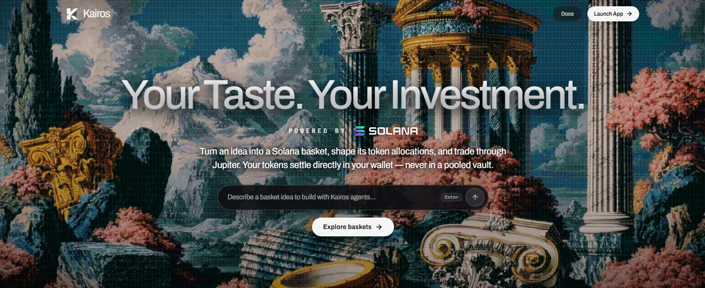
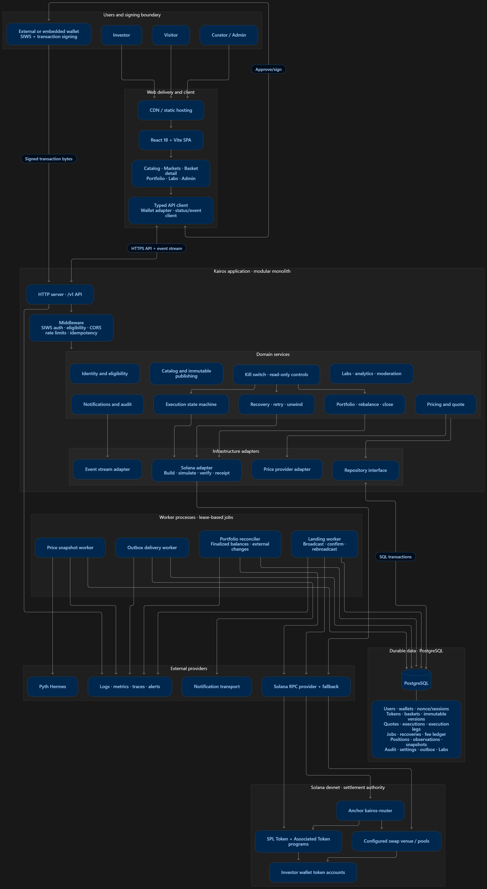

<p align="center">
  
</p>

<div align="center">

# Kairos — Thematic investing on Solana

**Your taste. Your investment.** Build a theme, choose its token allocation, and review a wallet-signed execution on Solana devnet.

[](https://solana.com)
[](https://react.dev)
[](https://www.typescriptlang.org/)
[](LICENSE)

<br />

[Architecture](#architecture) · [Product capabilities](#product-capabilities) · [Baskets](#curated-thematic-baskets) · [Tech stack](#tech-stack) · [Quickstart](#quickstart) · [Security](#security-and-wallet-control)

</div>

## Architecture

Kairos is a React web client backed by a TypeScript API, PostgreSQL, background workers, and a Solana Anchor router. Wallets retain signing authority; execution and recovery state are tracked by the backend.

<p align="center">
  
</p>

<p align="center"><em>Current delivery target: Solana devnet. Live routing depends on configured providers, pools, and router deployment.</em></p>

---

## Specification

The normative product contract for this milestone is
**[docs/PRD_V4.md](docs/PRD_V4.md)** (Kairos PRD v4.0, devnet only). Code, tests,
UI copy, and audits are measured against it. Current status against that contract
is tracked in [docs/PRD_V4_COVERAGE_AUDIT.md](docs/PRD_V4_COVERAGE_AUDIT.md).
The earlier product contract has been superseded by this devnet-scoped PRD v4.

## Current delivery contract

Kairos is a **devnet-first, non-custodial** Solana application. The local test and
build paths are reproducible without RPC access, a database account, or private
keys. Live devnet execution, router deployment, and oracle history require the
operator credentials described in `backend/.env.example` and are intentionally
not claimed by the offline checks.

- Runtime: Bun `1.4.2` (pinned by `.bun-version`, `package.json`, and `Dockerfile`).
- Persistence: PostgreSQL in deployment; PGlite-backed in-memory tests.
- Network: Solana devnet by default; mainnet is not a supported delivery target.
- Test command: `make test` (equivalent to `bun run test`).
- Secrets: never commit `.env`; use the tracked example templates.

## 📖 Executive Summary

Navigating decentralized finance and crypto markets requires managing dozens of volatile assets across isolated protocols. Traditional index products force users into synthetic vault contracts, introducing liquidation risk, manager lockups, and smart contract counterparty exposure.

**Kairos** pioneers non-custodial thematic investing on Solana:
- **Zero Custody**: The quote/prepare/submit flow targets the user's wallet. Program-backed atomic routing is enabled only after the configured devnet router is deployed and initialized.
- **Direct Wallet Ownership**: Every underlying token lands straight into your self-custodial wallet (Phantom, Solflare, Backpack).
- **Recovery-aware execution**: Landing, receipt checks, retries, close, and recovery state are persisted in PostgreSQL.
- **Explicit data status**: Provider snapshots and registry fallback data are labelled; unavailable history is not fabricated.

---

## Product capabilities

- **Wallet-controlled execution** — investors approve and sign transactions with their connected wallet; Kairos does not store wallet private keys.
- **Quote-bound trading** — the API builds signed transaction payloads and records execution state for landing, confirmation, and recovery.
- **Portfolio and market views** — browse baskets, inspect token allocations, and review available price and performance data with its source status.
- **Kairos Labs** — create and curate thematic baskets, subject to the app's current publishing and moderation controls.

The app is devnet-first. Router execution depends on the configured program, RPC, and swap pools; the architecture image describes the system boundary, not a claim that every external integration is live.

---

## Curated thematic baskets

| # | Basket Name | Focus Theme | Key Constituents | Target Strategy |
|---|-------------|-------------|------------------|-----------------|
| 1 | **Solana Culture & Memes** | Premier cultural liquidity | $BONK (40%), $WIF (35%), $POPCAT (25%) | High-beta consumer culture & community momentum |
| 2 | **Solana AI & Compute** | Decentralized compute & ML | $IO (35%), $RENDER (35%), $NOS (30%) | GPU clustering, distributed rendering & agentic AI |
| 3 | **Solana DePIN Infrastructure** | Physical decentralized networks | $HNT (40%), $MOBILE (30%), $HONEY (30%) | Decentralized telecoms, mapping & sensor grids |
| 4 | **Solana Infra Governance** | Core ecosystem protocols | $JUP (40%), $JTO (35%), $PYTH (25%) | Top-tier DeFi governance, MEV staking & oracles |
| 5 | **Solana Liquid Staking** | Yield-bearing staked SOL | $JitoSOL (40%), $mSOL (35%), $bSOL (25%) | MEV rewards + consensus staking compounding |
| 6 | **Solana DeFi Bluechips** | High-volume financial primitives | $RAY (40%), $ORCA (30%), $DRIFT (30%) | Concentrated liquidity, perpetuals & AMM trading |
| 7 | **Next-Gen Solana Layer 1s** | High-velocity interoperability | $PYTH (40%), $W (35%), $TNSR (25%) | Cross-chain messaging, data feeds & NFT tooling |
| 8 | **Solana Gaming & Metaverse** | Web3 gaming ecosystems | $ATLAS (40%), $AURY (35%), $SHDW (25%) | Decentralized storage & immersive virtual economies |
| 9 | **Stable Yield & RWA** | Low-volatility real world yields | $USDC (40%), $USDY (35%), $PYUSD (25%) | Tokenized treasuries and yield-generating stables |
| 10| **Solana Founders Conviction** | Anchor ecosystem leaders | $SOL (40%), $JUP (25%), $JTO (20%), $BONK (15%) | Core layer-1 momentum and proven liquidity anchors |

---

## Tech stack

### Frontend Client
- **Framework**: [React 18](https://react.dev/) + [Vite](https://vitejs.dev/)
- **Language**: [TypeScript](https://www.typescriptlang.org/)
- **Styling**: [Tailwind CSS](https://tailwindcss.com/) + Custom Glassmorphism Theme
- **Solana Web3**: `@solana/web3.js`, `@solana/wallet-adapter-react`, `@solana/wallet-adapter-react-ui`
- **Charting**: [TradingView Lightweight Charts](https://tradingview.github.io/lightweight-charts/)
- **Icons & Motion**: Lucide React, Framer Motion

### Backend Engine
- **Framework**: TypeScript HTTP service running on Bun
- **Language**: TypeScript
- **Database**: PostgreSQL with PGlite-backed offline tests
- **Price snapshots**: Pyth Hermes when configured; registry rates remain explicitly labelled test/devnet data
- **Execution**: signed Solana transaction builders and the Kairos Anchor router where the devnet program is deployed

### On-Chain Programs
- **Framework**: [Anchor Framework 0.31.1](https://www.anchor-lang.com/)
- **Language**: Rust
- **Target**: Solana Sealevel Virtual Machine (SVM)

---

## Quickstart

### Prerequisites

- [Bun](https://bun.sh/) `1.4.2` (the version in `.bun-version`)
- [Rust & Cargo](https://rustup.rs/) for program checks
- [Solana CLI](https://docs.solanalabs.com/cli/install) and [Anchor CLI](https://www.anchor-lang.com/docs/installation) for on-chain work
- Docker is optional; it is not needed for `make test`

### 1. Repository setup

```bash
bun --version                 # must print 1.4.2
bun install --frozen-lockfile
```

The root `bun.lock` covers both workspaces. Dependencies are installed locally;
do not install project packages globally.

### 2. Configure local environment files

```bash
# POSIX shells
cp backend/.env.example backend/.env
cp frontend/.env.example frontend/.env

# Windows PowerShell equivalents:
# Copy-Item backend/.env.example backend/.env
# Copy-Item frontend/.env.example frontend/.env
```

For a real backend run, set `DATABASE_URL`, `RELAYER_KEYPAIR`, and a fresh
`JWT_SECRET` in `backend/.env`. Keep these values local. The frontend template
only contains public `VITE_*` settings.

### 3. Local development

```bash
# Terminal 1: backend on http://localhost:3001
bun run start:backend

# Terminal 2: frontend on http://localhost:3000
bun run start:frontend
```

Vite proxies `/api`, `/v1`, `/health`, and `/ws` to the backend during local
development. `make run-backend` and `make run-frontend` are equivalent aliases.

For a demo rehearsal, run the two services together and then use the browser
smoke checker:

```bash
bun run demo
# In a second terminal:
bun run check:demo
```

The demo command seeds a planned devnet catalog when needed, builds the frontend, then serves it at `http://127.0.0.1:8080`; the API is at
`http://127.0.0.1:3001`. The preview proxies the API routes. The checker captures screenshots under
`target/demo/` and verifies `/`, `/markets`, `/portfolio`, `/labs`, and `/admin`.

For a pitch walkthrough, use the production frontend build and the configured
PostgreSQL backend together:

```bash
bun run build
bun run demo
```

Open `http://localhost:3000`. This uses the existing backend configuration; it
does not simulate successful transactions. `bun run check:devnet` reports the
signer balance, program deployment state, and estimated deployment rent without
printing secrets. Live investing requires initialized devnet tokens and pools.

### 4. Offline checks

```bash
# Required single test command; no RPC, Postgres account, or secrets needed.
make test

# Other local checks
make build
bun run --cwd backend typecheck
bun run check:contracts
```

The backend tests use an in-memory PGlite database. Tests that require a live
validator remain visible as documented skips; a skipped devnet test is not a
claim that the network flow works.

### 5. Docker build and run

The Dockerfile uses the pinned Bun image, installs the system certificates and
HTTP server needed by the image, installs from the frozen lockfile, and builds
both workspaces. Docker is not required for `make test`.

```bash
# Build the image. Optionally bake a different API URL into the SPA.
docker build --tag kairos:dev .

# Run the backend API; backend/.env is local and must not be committed.
docker run --rm --env-file backend/.env -p 3001:3001 kairos:dev

# Run the already-built frontend instead.
docker run --rm -e KAIROS_SERVICE=frontend -p 8080:8080 kairos:dev
```

### 6. Devnet setup and deployment

These commands require a funded operator wallet, RPC access, and a PostgreSQL
database. They are not part of the offline test contract.

```bash
# Prepare devnet registry/mint state after configuring backend/.env.
bun run --cwd backend setup
bun run --cwd backend seed

# Build and deploy the Anchor program only when the deployment wallet is ready.
anchor build
anchor deploy --provider.cluster devnet
```

For an OCI deployment, build and push `kairos:dev` (or a versioned tag), then
provide the same environment variables through the platform's secret manager.
Never put RPC keys, database credentials, relayer keypairs, admin tokens, or
JWT secrets in the image, README, or repository.

### 7. Solana smart program checks (optional)

```bash
anchor build
anchor test
```

---

## Repository structure

```
kairos/
├── backend/                  # TypeScript API, PostgreSQL repository & workers
│   ├── src/
│   │   ├── routes/           # Baskets, prices, swaps, and analytics endpoints
│   │   ├── services/         # Quoting, execution, recovery & fee ledger
│   │   └── config.ts         # Server configuration & environment validation
│   └── tests/                # Backend unit and integration test suite
│
├── frontend/                 # React 18 / Vite Web3 application
│   ├── public/               # Static brand assets, fonts, icons, banners
│   ├── src/
│   │   ├── components/       # UI components (Header, Footer, TechnicalChart)
│   │   │   ├── arc/          # Glassmorphic card and button foundations
│   │   │   ├── basket/       # InvestModal, HistoricalTabContent, Marquee
│   │   │   └── ui/           # Interactive 3D cylinder & carousel components
│   │   ├── hooks/            # useBasketNavHistory, useWalletPortfolio
│   │   ├── lib/              # baskets-data.ts, real-historical-nav.json
│   │   └── pages/            # Index, Markets, MarketDetailpage, Labs, Portfolio
│   └── tailwind.config.ts    # Design tokens, palette & typography
│
├── programs/                 # Solana Anchor programs
│   └── kairos-router/        # On-chain router for multi-token CPI distribution
│       ├── src/              # Rust instruction logic & account validation
│       └── Cargo.toml
│
├── docs/                     # Technical documentation & brand assets
│   ├── assets/               # Screenshots, banners, hero previews
│   ├── PRD_V4.md             # Normative product contract (devnet scope)
│   ├── PRD_V4_COVERAGE_AUDIT.md # Current requirement coverage & gaps
│   ├── BACKEND_DELIVERY.md   # Backend architecture & schema reference
│   └── KEY_ROTATION.md       # Production key management & operational security
│
├── scripts/                  # Deployment, seeding, and maintenance utilities
├── Anchor.toml               # Anchor workspace configuration
└── README.md                 # Project documentation
```

---

## Security and wallet control

- **Wallet signatures stay with the user.** Kairos builds transactions for the connected wallet to review and sign; wallet private keys are not sent to the API.
- **Execution is stateful and recoverable.** The backend records transaction and recovery state so workers can track landing and confirmation.
- **Network scope is explicit.** The supported delivery target is Solana devnet. Mainnet execution is not claimed by this README.
- **Keep secrets out of Git.** Store RPC credentials, database passwords, relayer keys, admin tokens, and JWT secrets in local environment files or a deployment secret manager.

---

## License

This project is licensed under the [MIT License](LICENSE).

---

<div align="center">
  <sub>Built with conviction for the Solana global community.</sub>
</div>
