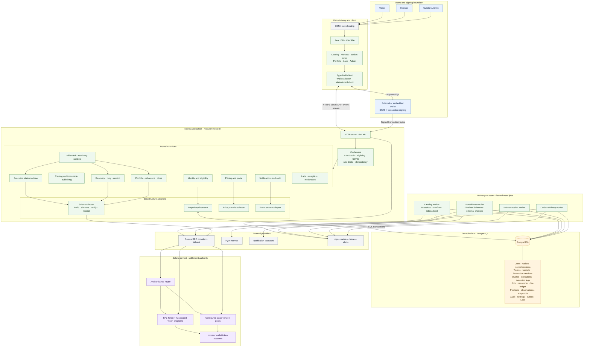
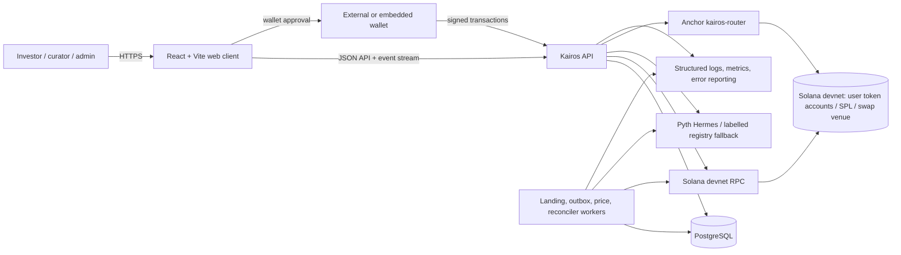
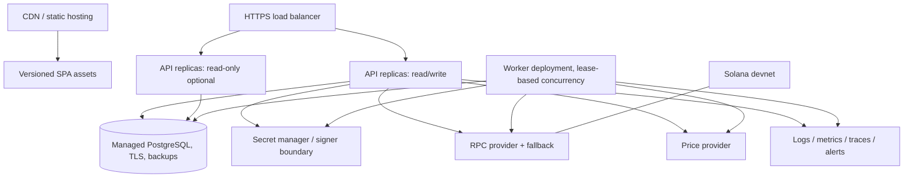

# Kairos Application Architecture

**Status:** Target architecture and current-state map  
**Scope:** Kairos v1.0, Solana devnet release. Mainnet is explicitly out of scope until a separate security, legal, operational, and acceptance review.  
**Normative product contract:** [PRD v4](PRD_V4.md). This document explains how to implement and evolve that contract; it does not override it.

## 1. Executive design

Kairos is a non-custodial thematic-investing web application. A user chooses an immutable basket version, reviews a quote, signs wallet transactions, and receives the underlying SPL tokens in their own Solana wallet. Kairos stores workflow state and observations; the blockchain remains authoritative for asset ownership and transaction settlement.

Use a **modular monolith** for the API and worker runtime, a **React/Vite SPA**, **PostgreSQL** for durable workflow state, and one **Anchor router program** where program-backed atomic routing is configured. Keep modules behind explicit service/provider interfaces. This keeps the current small-team deployment operable while preserving seams for later worker or service extraction. Do not introduce Redis, BullMQ, microservices, or a second indexer solely for architectural fashion: the current PostgreSQL jobs/outbox and workers are the baseline. Add infrastructure only when measured throughput or reliability requires it.

### Architecture decisions

| Decision | Choice | Reason / constraint |
|---|---|---|
| Application shape | Modular monolith, independently runnable API and worker roles | Shared domain and transaction boundaries; allow worker scaling without splitting business logic. |
| Client | React 18 + Vite + TypeScript SPA | Current implementation; wallet interaction and static asset hosting fit this app. |
| Server | Bun + TypeScript HTTP API, route/middleware/service/repository layers | Current implementation; keep framework-neutral HTTP boundary and validated contracts. |
| Durable state | PostgreSQL with SQL migrations and repository abstraction | Required for idempotency, row locks, job leases, outbox, audit, and recovery across restarts. |
| Chain | Solana devnet; Anchor `kairos-router`, SPL token accounts, configured swap venue | Devnet is the release target; no mainnet-readiness assertion. |
| Signing/custody | User wallet signs asset movement; Kairos relayer is fee payer/operator only | Never persist user private keys or accept an unsigned authorization to move user funds. |
| Pricing | Provider abstraction; Pyth snapshots when configured; registry/devnet data clearly labelled | Reject stale/unavailable data for execution; never present fallback/demo data as verified market history. |
| Async work | PostgreSQL-backed jobs + leases, outbox, poll/reconcile loops | Durable restart semantics without a separate broker at current scale. |
| Deploy | Containerized API/worker and static SPA; managed PostgreSQL; secret manager | Separate scaling and credentials while retaining one versioned application artifact. |

## 2. System context and container view

### Full application architecture



**How to read it:** the wallet owns signing authority and user assets; the API coordinates and verifies requests; PostgreSQL persists Kairos workflow state; workers continue settlement and reconciliation after the browser closes; Solana is authoritative for token ownership and settlement. The relayer must remain constrained to explicitly approved operational signing and fee-payer duties.



**Trust boundaries:** the browser is untrusted; wallet signatures are user authorization. API input, provider responses, transaction bytes, and RPC observations are untrusted until validated. PostgreSQL is the durable application ledger, not the authority for actual token balances. Solana finalized account/transaction state is the settlement and ownership source. Admin and publishing actions require authenticated roles and audit trails.

## 3. Component responsibilities

### Web client

- Public catalog, markets, basket detail, version history, portfolio, position details, execution status, Labs, settings, and admin surfaces.
- Wallet adapter/provider boundary for SIWS authentication and transaction signing. Keep secrets in wallet/provider; do not send seed phrases or private keys to Kairos.
- Quote and signing UI renders server-supplied quote data with price source/as-of, expiry, fees, slippage, receive estimates, custody disclosure, and network/cluster. Never infer the human-readable intent from opaque transaction bytes.
- Submit signed bytes with the prepare ID and idempotency key. Render durable execution states and recover from refresh by execution ID.
- Use typed API clients and shared response schemas; do not duplicate fee, basket-weight, or state-machine rules in UI.
- Treat prices and history as time-stamped data with provenance and explicit hypothetical/demo labels.

### API and domain modules

`backend/src/routes` owns transport, authentication/authorization checks, input parsing, response mapping, and HTTP status. `middleware.ts` owns cross-cutting request policy. `services` own domain rules and orchestration. `db/repository.ts` is the persistence boundary. `chain` owns RPC, transaction, mint, allowlist, balance, and receipt adapters. Keep domain decisions out of route handlers and React pages.

| Module | Owns | Core invariants |
|---|---|---|
| Identity & eligibility | SIWS nonce/session, wallet linkage, region and age/eligibility gates | Challenge is single-use/expiring; wallet proves control; reject restricted or incomplete eligibility on all money paths. |
| Catalog & publishing | Tokens, baskets, immutable versions, proposals, approvals | Published versions are append-only; weights total 10,000 bps; two distinct approvers; approved mints/liquidity evidence. |
| Pricing & quote | Provider adapters, snapshots, freshness, quote calculation | Decimal-safe base units; source, confidence, timestamp, route, and expiry persist; stale/unknown price cannot authorize execution. |
| Execution | Prepare, simulate, verify, submit, state transitions | Wallet-scoped idempotency; stored message hashes; signature and message bytes verified; kill switch checked at every buy path. |
| Landing & recovery | Job claims, broadcast/confirm/rebroadcast, receipt parsing, retry/unwind | Resume identical signed bytes; do not manufacture success from quote; charge fees only for confirmed legs and once. |
| Portfolio & rebalance | Chain balance reconstruction, drift, preview, close, rebalance | Chain observations carry commitment/time/source; external modification disables auto-rebalance; sell-before-buy funding is verified. |
| Notifications & audit | Transactional outbox, preferences, admin audit | Domain change and outbox row commit atomically; delivery is lease/acknowledgement based; admin actions are attributable. |
| Labs & analytics | User basket drafts, moderation/voting, privacy-aware analytics | User-generated content is untrusted; moderation and rate limits precede promotion; analytics minimize identifiers. |
| Operations controls | Kill switch, read-only mode, allowlists, health/metrics | Fail closed for new buys on uncertainty; close/unwind/withdraw safety exits remain available per policy. |

### Worker roles

Run workers as a separate process/container in production, even though local development can run them with the API. The process may enable one or more lanes: landing queue, outbox delivery, price snapshots, and portfolio reconciliation. Use DB leases/claims and per-job idempotency so multiple replicas can compete safely. A worker must expose liveness/readiness and queue lag, avoid overlapping its own tick, bound concurrency, and shut down gracefully. Read-only API instances do not run workers.

## 4. Critical data flows

### 4.1 Authenticate and quote

1. Client requests a short-lived nonce; server stores it and returns expiry.
2. Wallet signs a domain-bound SIWS message; server verifies signature, nonce, origin/cluster, and consumes nonce atomically. Issue short-lived access credentials; refresh rotation/revocation is persisted.
3. Client requests quote for basket version and amount. Server checks identity, eligibility/region, active immutable version, token status/allowlist/liquidity, kill switch, and provider freshness.
4. Quote service calculates fees and each leg in integer base units, obtains route/min-out information, and stores quote with version, provenance, and expiration. Client receives a display-ready preview.

### 4.2 Prepare, sign, submit, land

```mermaid
sequenceDiagram
  participant C as Client
  participant A as API
  participant D as PostgreSQL
  participant W as User wallet
  participant R as Solana RPC / router
  participant L as Landing worker
  C->>A: prepare(quote, idempotency key)
  A->>A: authorize, validate, build, allowlist, simulate
  A->>D: persist execution + tx bytes + hashes + jobs
  A-->>C: unsigned transactions + display summary + expiry
  C->>W: request signature
  W-->>C: signed transaction bytes
  C->>A: submit(executionId, signed bytes, idempotency key)
  A->>A: verify signature, message hash, expiry, signer, policy
  A->>D: atomic state transition + durable landing jobs
  A-->>C: accepted + execution status
  L->>D: claim job with lease
  L->>R: send signed bytes; query signature history; confirm
  R-->>L: finalized/confirmed receipt or failure
  L->>D: leg receipt, fee ledger, position update, outbox event
  C->>A: status or event stream
  A-->>C: durable execution state
```

Persist prepare before returning it. Persist submit acceptance and queue job in one database transaction. Verify every signed message against the prepared message and required signer before broadcast. Broadcast the exact stored signed bytes; after timeout, query signature status/history before deciding whether rebroadcast or expiry is safe. Parse confirmed receipt deltas for actual outputs. Use explicit states `PREPARED → SUBMITTED → LANDING → COMPLETED | PARTIALLY_COMPLETED | FAILED | EXPIRED`; transitions are validated centrally and terminal outcomes are monotonic except explicit recovery executions linked to their ancestor.

### 4.3 Retry, unwind, close, rebalance

Recovery creates a new execution linked to the base execution with a unique reservation per recovery action. Reserve/claim under a DB transaction so concurrent retries cannot spend the same proceeds. Retry only failed legs; unwind sells only confirmed holdings; store actual input/output and fees from receipts. Rebalance plans sells and buys from actual holdings; buy jobs wait for confirmed sale proceeds and a funding check. Close/unwind routes remain operable during buy-side kill switch where safe. A failed or ambiguous RPC result is `unknown/pending` until chain history and block-height expiry resolve it; never infer failure just from a timeout.

### 4.4 Portfolio and event updates

Portfolio is reconstructed from wallet token balances and verified receipts, enriched with latest valid price snapshots. A periodic reconciler observes finalized balances, updates observation provenance, marks material external changes `MODIFIED`, disables auto-rebalance, and writes audit/outbox records. Event streams are an optimization; clients can always fetch canonical state by resource ID after reconnect. Notification outbox is written in the same transaction as the state change and delivers at least once with idempotent event IDs; exactly-once external delivery cannot be promised unless the recipient transport supports deduplication.

## 5. Data architecture

PostgreSQL is the source for Kairos workflow and configuration. Existing SQL migrations and repository abstraction are canonical. Use UTC timestamps, explicit status enums/check constraints, foreign keys, unique keys, and indexes for every worker claim/list query. Schema changes are forward-only, idempotent migrations; take backups and test migrations against a production-like copy before release.

| Entity family | Key records | Important constraints |
|---|---|---|
| Identity | `users`, `wallets`, nonce/session/refresh records | Unique wallet address; short-lived, single-use nonce; revoke sessions. |
| Catalog | `tokens`, `baskets`, `basket_versions`, `basket_legs`, proposals, allowlists | `(basket_id, version)` unique; published versions/legs immutable; leg weights sum 10,000 bps. |
| Market | quotes, price snapshots, provider metadata | Quote pins immutable version; source/ref/time/confidence and base-unit amounts retained; stale rows not silently refreshed. |
| Execution | executions, execution legs, jobs, recoveries, fee ledger | `(wallet_id, idempotency_key)` unique; request hash detects key reuse; per-leg fee unique; recovery reservation unique by ancestor/action. |
| Portfolio | positions, position legs/observations, rebalance events | Wallet + basket identity; observation commitment, source, timestamp; external modification audited. |
| Governance/ops | settings, audit log, outbox, notification preferences, analytics | Audit actor/action/entity/time; outbox lease token/attempts; minimize and expire analytics identifiers. |
| Labs | drafts, comments, votes/moderation records | Unique vote identity; bounded content; moderation status transitions audited. |

Store monetary values as integer atomic units (`BIGINT` where range permits, or decimal strings/`NUMERIC` if values can exceed that range); never use binary floating point for fee, balance, or transaction construction. If legacy read/display fields remain floating-point, derive them only at the presentation boundary and reconcile against base-unit columns. Keep raw signed transactions only as long as recovery/retention policy requires; encrypt sensitive operational data at rest and restrict DB access by service role.

### Consistency model

- PostgreSQL transactions enforce API invariants, idempotency, fee ledger, job creation, recovery reservations, and outbox atomicity.
- RPC is eventually consistent and may return stale/ambiguous results. Record commitment and observation time; finalized is the default portfolio source for authoritative reconciliation.
- Basket versions are immutable snapshots; a quote/execution references the exact version ID, not the mutable active pointer.
- External side effects are never assumed atomic with PostgreSQL. Use durable intent/jobs, idempotent broadcast, signature lookup, and reconciliation to close the gap.

## 6. API and contracts

Keep `/health` and `/healthz` operationally distinct: cheap liveness versus dependency-aware readiness. Version public APIs under `/v1`. Routes should have request/response schemas and stable machine-readable error codes; reject unknown or malformed fields and enforce payload limits. Authenticate wallet-owned reads/writes and admin roles server-side. Apply CORS to exact configured origins, rate limits by IP and wallet, and idempotency headers to all money-changing requests. Keep API types generated or contract-tested against a shared schema to prevent frontend/backend drift.

Representative resources: `/v1/auth/*`, `/v1/catalog/*`, `/v1/quotes`, `/v1/executions/prepare`, `/v1/executions/:id/submit`, `/v1/executions/:id`, `/v1/executions/:id/retry`, `/v1/executions/:id/unwind`, `/v1/portfolio/:wallet`, `/v1/positions/:id/rebalance`, `/v1/positions/:id/close`, `/v1/notifications`, `/v1/admin/*`. Keep route naming consistent with the existing API during implementation; this list is a logical contract, not a mandate for a breaking rename.

## 7. Security, privacy, and safety

### Key and transaction security

- User signing keys never enter Kairos. Relayer private key is isolated from API read paths and loaded from a secret manager/KMS-backed signer in production; rotate, scope, monitor, and revoke it. Never put it in image layers, logs, source, or database.
- Restrict relayer to fee payment and explicitly reviewed program instructions; rate-limit spend, enforce balance ceilings/alerts, and stop signing on policy mismatch. Add transaction simulation plus program/mint/account allowlists before asking for user approval and again before broadcast.
- Bind prepared transaction to user, wallet, quote, basket version, cluster, expiry/block height, signer set, and message hash. Reject altered bytes, wrong cluster, stale quote, replay, wrong fee payer, and duplicate conflicting requests.
- Anchor program validates authority, pause state, basket/version, allowed mints, bounds, slippage/min-out, and CPI programs. Admin/publish authority must be distinct and auditable; emergency pause cannot prevent user exits that are defined as safe.
- Admin console uses strong MFA/SSO, least privilege, separate admin origin, step-up for kill switch/publish/key actions, and dual control for publishing. Never expose admin bearer tokens to the SPA build.

### Application and data security

- TLS everywhere; strict CORS, CSP, HSTS, secure cookie policy where cookies are used, CSRF protection for cookie-authenticated mutations, request size/rate limits, output encoding, dependency/container scanning, and secret redaction.
- Validate wallet signatures and SIWS domain/origin/nonce; short access TTL, refresh-token rotation, session revocation. Region/age/eligibility enforcement is server-side on every quote/prepare/submit/recovery path.
- Treat all external feeds, metadata, Labs content, and admin input as hostile. Validate price freshness/confidence, mint decimals, URLs, and content length. Do not trust client-supplied balances, fee amounts, basket weights, role, region, or execution status.
- Minimize personal data and analytics; define retention and deletion policy; redact wallet identifiers in logs except where operationally necessary. Audit access to user-specific execution and portfolio data.
- Publish a threat model and incident runbooks before any real-value release. Devnet completion does not establish mainnet safety or legal availability.

## 8. Reliability and observability

**Service objectives:** use PRD targets as hypotheses to measure: quote/prepare latency, landing success, partial completion, reconciliation lag, support burden, fee duplication, tampered transaction acceptance, and unauthorized movement. Do not label a target achieved until measured on configured devnet with reproducible evidence.

Emit structured JSON logs with request ID, execution ID, job ID, wallet pseudonym, cluster, attempt, state transition, signature, and error code. Do not log secret keys, auth tokens, full signed transaction payloads, or unrestricted personal data. Metrics: HTTP latency/error by route, DB pool saturation, RPC/provider latency and error rate, stale-price count, quote expiry, queue age/depth/attempts, landing confirmation latency/outcomes, reconciliation lag/divergence, outbox oldest age, relayer SOL balance, and kill-switch/read-only state. Trace API → DB/job → RPC where possible. Alert on relayer low balance, paused/failed workers, growing queues, stale feeds, DB exhaustion, unexpected fee mismatches, and repeated tamper/auth failures.

Failure handling: bounded retries with exponential backoff and jitter for transient provider failures; no retries for validation/security failures; dead-letter/quarantine after configured attempts with operator visibility; graceful shutdown stops new claims and lets in-flight transactions persist their checkpoint. Back up PostgreSQL with tested restore; preserve migration/version and on-chain program IDL/artifact provenance. Run chaos drills for RPC outage, worker crash after send-before-ack, DB outage, stale prices, duplicate submit, and kill switch.

## 9. Deployment topology



- **Local:** Vite and Bun API; in-memory PGlite tests. Live execution requires explicit devnet configuration.
- **Devnet/demo:** static SPA served via CDN or container; API and worker; managed PostgreSQL; devnet-only RPC credentials; relayer funded minimally; router address/IDL pinned. All fallback or simulated data visibly labelled.
- **Production hardening (still devnet unless separately approved):** multiple stateless API replicas; separate worker replica(s); managed PostgreSQL with TLS, backups/PITR and connection limits; WAF/CDN; secret manager; central telemetry; signed container/SBOM; staged rollout and rollback. Ensure only one migration runner holds migration lock and worker leases protect parallel replicas.
- **Mainnet:** separate release decision, independent audit and threat review, legal/eligibility design, external wallet and relayer key controls, program upgrade authority plan, real-liquidity acceptance, incident and support coverage, and explicitly approved economic limits. No inherited devnet setting should enable mainnet by accident.

## 10. Repository mapping and code ownership

```text
frontend/src/{pages,components,hooks,lib}     SPA, wallet, typed API client
backend/src/routes                             HTTP controllers
backend/src/middleware.ts                      auth, CORS, rate/eligibility guards
backend/src/services                           domain modules and orchestration
backend/src/db/{schema,repository,migrate}.ts  persistence contracts and SQL DDL
backend/src/chain                              Solana/RPC/provider adapters
backend/src/workers                            durable async processing
programs/kairos-router/src                     Anchor instructions, state, errors
shared/                                        cross-package configuration/contracts
scripts/, backend/scripts/                     operator and acceptance tooling
docs/                                          product contract, runbooks, architecture
```

Dependency direction: routes → services → repository/provider interfaces. Services may depend on domain types and interfaces, not HTTP response objects. Chain and price adapters implement interfaces consumed by services. Frontend consumes API contracts only. Anchor program is a separately versioned security boundary; backend must pin the expected program ID, IDL/account layout, and supported instruction version. Avoid circular service imports; extract common pure domain rules to focused modules.

## 11. Delivery roadmap and acceptance gates

1. **Baseline and contract:** reconcile `PRD_V4_COVERAGE_AUDIT.md` against current branch; freeze error codes, state machine, API schemas, and devnet configuration. Record all unsupported flows visibly.
2. **Safety closure:** close Must-level audit gaps: eligibility and age enforcement, token liquidity evidence, all-path kill switch tests, notification preference/write and real delivery transport, and authoritative USDC mint/config. Review security controls and migrations.
3. **Live devnet vertical slice:** fund relayer, deploy and initialize router, configure pools/feed and provider, run invest → receipt → portfolio → retry/unwind → close; capture signatures, RPC receipts, fees, and recovery evidence. No mocked result counts as live acceptance.
4. **Operational readiness:** multi-process worker lease tests, restart/outage drills, DB restore exercise, alert/runbook validation, measured NFRs and device/browser acceptance; verify idempotency, no double fee, no unauthorized movement.
5. **Release:** pin image/IDL/config, deploy staged, verify health and metrics, retain rollback artifacts, publish known limits and user-facing risk disclosures. Mainnet remains a separate program of work.

Each gate should link to evidence in the delivery audit. Existing local automated checks are useful engineering signals; they do not substitute for live chain, key-management, UX acceptance, or security audit.

## 12. Known current gaps and explicit non-claims

This design is grounded in current code and delivery records. The application already has route/service/repository/chain boundaries, PostgreSQL migrations, PGlite-backed tests, execution state and recovery, jobs/outbox workers, price snapshots, reconciliation, and an Anchor router. The architecture is therefore an evolution plan, not a greenfield rewrite.

The checked-in delivery audit records live devnet acceptance as blocked/unverified until operator prerequisites are met; Pyth configuration, deployed/initialized router and live pool acceptance, and real transaction receipts must be evidenced. The PRD coverage audit also lists partially implemented eligibility/liquidity, notification delivery, analytics/privacy, annotation, frontend/accessibility, and operational NFR work. Re-read the latest audit before using these statuses: audit snapshots are dated and can become stale. Do not claim production, mainnet, legal, or custody guarantees from this document.

## 13. Glossary

- **Basket version:** immutable allocation snapshot identified by basket + version.
- **Prepare:** validate quote and build unsigned wallet transactions.
- **Landing:** broadcast, confirm, and reconcile a user-signed transaction.
- **Partial completion:** some basket legs settled while others failed or remain unresolved.
- **Outbox:** durable event record committed atomically with the domain change that produced it.
- **Relayer:** Kairos-controlled signer limited to permitted fee-payer/operational duties; not a custodian of user assets.
- **Finalized observation:** balance/receipt read at Solana finalized commitment with timestamp and provenance.
