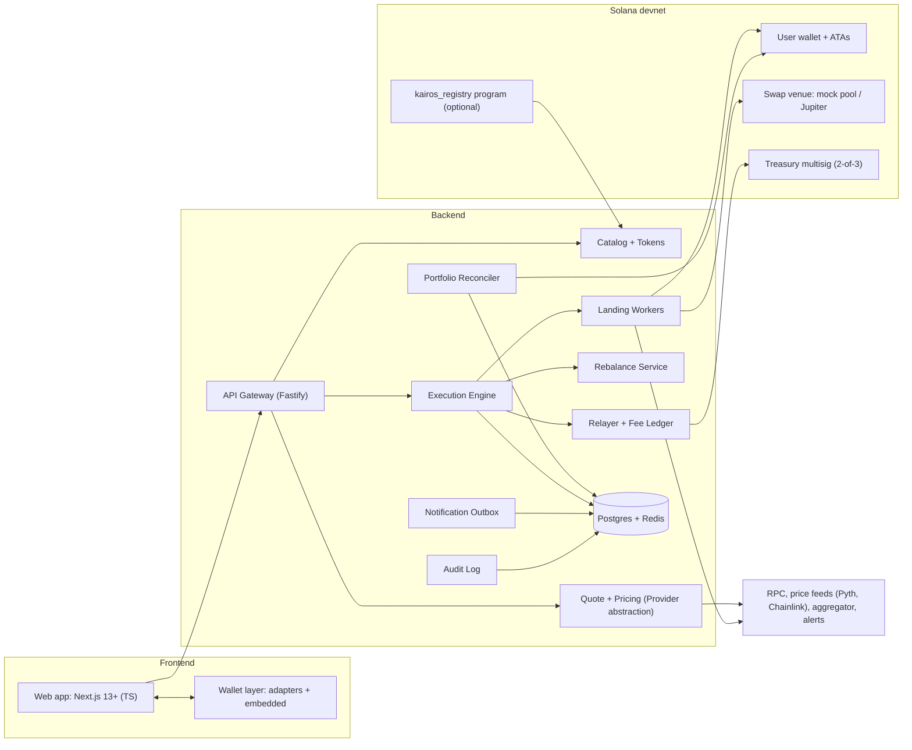

> **Status: NORMATIVE CONTRACT.** This document is the versioned source of truth
> for the Kairos v1.0 milestone. Code, tests, UI copy, and audit documents are
> measured against it. Where this file and any other document disagree, this file
> wins; where this file and the code disagree, that is a defect to record in
> `docs/PRD_V4_COVERAGE_AUDIT.md` — never a reason to silently reinterpret the
> contract.
>
> - **Product:** Kairos — non-custodial, narrative-basket investing on Solana
> - **Version:** v4.0 · 2 Nov 2025
> - **Chain scope:** Solana only
> - **Release target for this milestone:** **Solana devnet only.** Mainnet is a
>   later, separate release and no work in this milestone may assume or claim
>   mainnet readiness.
> - **Current coverage:** see [PRD_V4_COVERAGE_AUDIT.md](PRD_V4_COVERAGE_AUDIT.md).
> - **The earlier `Kairos — Full Product & System PRD v3.md` in the repository root
>   is retained as historical context only.**

---

# Kairos — Full Product & System PRD (v4.0)

**Product:** Non-custodial, narrative-basket investing on Solana
**Version:** v4.0 · 2 Nov 2025
**Target deployment:** Solana **devnet** (final deliverable). Mainnet is a later, separate release.
**Chain scope:** Solana only

> *This PRD merges the original Kairos specification with the proven patterns observed in Cesto.co (basket creation, community labs, performance graphs, simulations, version history, annotations, etc.) and adds explicit safety, observability, and devnet-focused details.*

---

## 0. Revision History

| Version | Date | Summary of changes |
|---------|------|--------------------|
| v1.0 | 2024-09 | Initial concept – non-custodial baskets, basic flow. |
| v2.0 | 2025-03 | Added fee-per-leg, blockhash expiry, partial-completion state. |
| v3.0 | 2025-07 | Full frontend/backend specs, Solana layer, devnet plan. |
| **v4.0** | **2025-11** | Integrated Cesto.co Labs, performance annotations, version history, simulation API, explicit notification/audit-log, refined NFRs, updated roadmap & risk matrix. |

---

## 1. Product Overview

### 1.1 Vision
*"Invest in what you believe."* A user selects a themed basket (e.g., *Solana Infrastructure*, *AI Leaders*, *GTA VI Launch*), inputs a USDC amount, approves the required transactions, and ends up holding the **real underlying SPL tokens** in their own wallet. No vault, no IOU token, no custodial intermediary.

### 1.2 Goals

1. **Speed** – One guided flow from basket selection to holding assets in **≤ 60 seconds** (devnet: test USDC).
2. **Non-custodial safety** – Backend never holds user funds or private keys; every on-chain movement requires a user-signed transaction (except an explicitly opted-in, policy-scoped auto-rebalance).
3. **Transparency before signing** – Show fee, expected receive amount, slippage impact, and custody note.
4. **Recoverable partial state** – If some legs fail, the user sees a clear `PARTIALLY_COMPLETED` state with retry/unwind options; no hidden loss.
5. **Immutable, versioned baskets** – Curators publish baskets that cannot be mutated; funds move only when the user explicitly rebalances to a new version.
6. **Honest performance** – All backtests and historical graphs are labelled *hypothetical* with a disclosed methodology; benchmark vs. S&P 500 (or SOL) is provided.

### 1.3 Non-Goals (v1 / devnet)

- Custody, pooled vaults, basket share tokens.
- Leverage, perpetuals, lending legs.
- Prediction-market legs (unless added later via an opt-in extension).
- Fiat on/off-ramps.
- Prompt-to-basket AI generation.
- Any chain other than Solana.
- Mainnet launch with real funds.
- Native mobile apps.

### 1.4 Users & Actors

| Actor | May do | Must not do |
|-------|--------|-------------|
| **Visitor** | Browse catalog, view backtests, read basket details. | Sign transactions or see a portfolio. |
| **Investor (external wallet)** | Connect wallet, invest, rebalance, close, withdraw, view portfolio. | Have keys held by Kairos. |
| **Investor (embedded wallet)** | Same as external, plus opt-in to policy-scoped auto-rebalance. | Authorize actions outside the defined policy. |
| **Curator** | Draft baskets, propose new versions, add rationale. | Publish alone (requires 2-person approval); touch user positions. |
| **Admin** | Approve publishes, trigger kill switch, adjust config, view audit log. | Bypass 2-person publish, move user funds. |
| **Support** | Read executions, portfolio state, notifications. | Move funds or edit positions. |
| **Backend / Relayer** | Build & verify unsigned txs, land signed txs, pay gas/fee, rebroadcast. | Move funds without a user signature. |

### 1.5 Success Metrics (devnet)

| Metric | Target |
|--------|--------|
| Prepare latency (p95, ≤ 6 legs) | ≤ 3 s |
| Leg landing success (7 d) | ≥ 99 % |
| Partial-completion rate | ≤ 3 % |
| Reconciliation lag (p95) | ≤ 30 s |
| Support tickets per 100 executions | ≤ 3 |
| Fee double-charge incidents | 0 |
| Transaction-tamper acceptance | 0 |
| Idempotency collisions | 0 |
| Unauthorized fund moves | 0 |

---

## 2. Scope (MoSCoW)

| Priority | Items |
|----------|-------|
| **Must** | • Catalog + immutable versions  <br>• Prepare/sign/submit engine with byte-level verification  <br>• Multi-leg buys with partial-completion state  <br>• Portfolio reconstruction from on-chain balances  <br>• Close & withdraw  <br>• Gas relayer + per-fee ledger  <br>• Kill switch  <br>• Notification outbox (exactly-once)  <br>• Web app (catalog, basket detail, invest panel, signing/status, portfolio, settings, admin console) |
| **Should** | • Manual rebalance  <br>• Backtests & hypothetical performance graphs  <br>• Auto-rebalance with policy (embedded wallets only)  <br>• Versioning, `kairos_registry` (optional), backtests, simulation API, annotation layer, admin console, chaos tests, observability hooks. |
| **Could** | • Labs / UGC basket creation & community voting  <br>• Multi-aggregator routing (Jupiter + fallback)  <br>• Loyalty points / rewards  <br>• Advanced order types (TWAP, VWAP)  <br>• Cross-chain bridges (future) |
| **Won't (now)** | • Custody or vaults  <br>• Leverage / margin  <br>• Prediction-market legs (unless later extension)  <br>• Fiat on/off-ramps  <br>• Prompt-to-basket AI  <br>• Mobile apps |

---

## 3. System Architecture



### 3.1 Layers

| Layer | Responsibility |
|-------|----------------|
| **Frontend** | Presentation, wallet interaction, human-readable transaction preview, live status, Labs UI, voting, comments. |
| **Backend** | Quotes, building unsigned txs, simulation, verification, landing, indexing, versioning, notifications, audit log, rebalance policy engine, fee ledger. |
| **Solana** | Source of truth for holdings. Programs used: SPL Token, Associated Token Account, Compute Budget, Memo, swap venue (Jupiter or mock), optional `kairos_registry`. Treasury multisig collects fees. Relayer wallet pays gas & ATA rent. |

### 3.2 Authority Matrix

| Party | Authority |
|-------|-----------|
| **User** | Signs their own transactions; keys never leave wallet/provider. |
| **Backend** | Builds unsigned txs, verifies signed bytes, lands, indexes, sends notifications, writes audit log. Cannot move user funds. |
| **Relayer** | Fee payer & ATA-rent payer; only signs transactions that have passed simulation & allow-list checks. |
| **Curator / Admin** | Publish via 2-person approval; kill switch; no access to positions. |
| **Treasury Multisig** | Receives USDC fees; sweeps only on schedule. |
| **Embedded Wallet Provider** | May hold a scoped signing key for auto-rebalance, revocable per-leg. |

### 3.3 Tech Stack

| Layer | Choice |
|-------|--------|
| **Frontend** | Next.js 13+ (React) + TypeScript, Solana Wallet Standard adapters (Phantom, Solflare, Backpack, embedded), TanStack Query, Tailwind CSS (utility-first). |
| **Backend** | Node.js / Bun + TypeScript, Fastify, Postgres + Drizzle ORM, Redis (caching & pub/sub), BullMQ (job queues). |
| **Solana** | `@solana/kit` (web3.js), Anchor 0.30+ for optional registry program, `@solana/spl-token` & associated-token-account. |
| **Providers** | Helius/Triton RPC (devnet + mainnet fallback), Jupiter aggregator (mainnet), mock swap pool (devnet), Pyth Network (price), Chainlink (optional fallback), Privy/Para (embedded wallet) behind an interface. |
| **Observability** | OpenTelemetry → Prometheus/Grafana, Sentry for error tracking, structured logging. |
| **CI/CD** | GitHub Actions, Docker, Terraform (devnet infra). |

> **Stack deviations recorded by the implementation:** the shipped stack is
> React 18 + Vite (not Next.js), Bun + a custom TypeScript HTTP server (not
> Fastify), PostgreSQL with SQL migrations and in-repo workers (no Drizzle,
> Redis, or BullMQ), and one Anchor `kairos-router` program that carries the
> optional registry role. These deviations were accepted because the sections
> below define the behavioural contract; the illustrative stack choices are not
> themselves requirements. See `PROJECT.md` ("Product constraints").

---

## 4. Frontend Requirements

### 4.1 Pages

| Page | Content | Key Behaviors |
|------|---------|---------------|
| **Home / Catalog** | Basket grid, category filters, live prices, "devnet / test data" banner. | Cached reads, skeleton loading, infinite scroll. |
| **Basket Detail** | Thesis, composition table (mint, weight, live price, rationale), version history, backtest/hypothetical graph, risk tab, annotations (news/events), liquidation info, checkpoints, incentives. | Switch between versions; shows "hypothetical performance" label; "Verified on-chain" badge if registry hash matches. |
| **Invest Panel** | USDC input (min ≥ 25 USDC), per-leg preview (amount, fee, min-out), total fee, estimated receive, price impact, custody note, expiry countdown. | Disabled until wallet connected & eligible; auto-refresh on expiry; shows "Approve X of Y" if sequential signing needed. |
| **Signing & Status** | Per-leg progress (pending, sent, confirmed, failed), signatures with explorer links, fee charged so far, retry/failed-leg actions. | Survives refresh/resume via `executionId`; shows countdown to block-height expiry. |
| **Portfolio** | Positions with live value, P&L, current vs target weights, drift, "new version available" badge, auto-rebalance toggle. | Provisional marker while data is `confirmed` but not `finalized`; external modification flag (`MODIFIED`). |
| **Position Detail** | Leg table (amount, weight, price, P&L), history, rebalance & close actions, auto-rebalance policy summary. | Shows policy disclosure before enabling auto-rebalance. |
| **Rebalance Preview** | Sell/buy legs, fee, impact, version diff, slippage, estimated receive. | Same signing flow as invest. |
| **Settings** | Wallet management, session, auto-rebalance policies, revoke embedded signing, notification preferences. | One-click revoke of embedded signing key. |
| **Admin Console** (separate app, SSO + 2FA, IP-restricted) | Basket drafts, publish approval (2-person), kill switch, executions, relayer balance, audit log viewer, system health. | Role-based access; publish requires two distinct admin approvals. |

### 4.2 Wallet UX

- **Connect:** Wallet Standard adapters (Phantom, Solflare, Backpack) **or** embedded wallet (email, Google, X, Telegram).
- **Auth:** Sign-In-With-Solana (nonce + signature) for external wallets; embedded wallets use provider-specific session.
- **Signing:**
  - If wallet supports `signAllTransactions` → **one approval prompt** (all leg txs).
  - Else → **sequential prompts** with a progress bar ("Approve 2 of 5").
- **Pre-signature UI:** Must render the human-readable summary **from backend data** (never from raw tx bytes).
- **Network mismatch:** On devnet, detect wrong cluster and prompt to switch to devnet RPC.

### 4.3 State Rendering (Backend → UI)

| Backend state | UI representation |
|---------------|-------------------|
| `PREPARED` | Summary, countdown, "Approve" button. |
| `SUBMITTED` / `LANDING` | Per-leg spinners, "Submitting…", disable resubmit. |
| `COMPLETED` | Delta in portfolio, explorer links, fee charged, "Success". |
| `PARTIALLY_COMPLETED` | Per-leg table (✅/❌), **Retry failed legs**, **Unwind landed legs**, fee only on confirmed legs. |
| `FAILED` | Reason, "nothing was charged", new prepare button. |
| `EXPIRED` | "Price expired. Please re-preview." |
| `REJECTED` | "Security check failed. Your signature was not used." |
| `MODIFIED` (external transfer) | Position badge "Modified outside Kairos", excluded from auto-rebalance. |

### 4.4 Confirmation Summary (verbatim)

```
You are investing:     100.500000 USDC
Fee (per asset):         0.201000 USDC (20 bps)
Estimated receive:      ~99.9 USDC of assets across 5 legs
Custody:                Assets go to your wallet. Kairos holds nothing.
Quote expires in:       00:58
```

### 4.5 Frontend NFRs

| ID | Requirement |
|----|-------------|
| FE-01 | LCP ≤ 2.5 s on catalog & basket pages (4G, mid-range phone). |
| FE-02 | Fully usable at 360 px width; keyboard navigable; WCAG 2.1 AA; no state conveyed by color alone. |
| FE-03 | No private keys or tokens in `localStorage`; session via httpOnly cookie or short-lived JWT. |
| FE-04 | CSP with pinned origins; wallet & RPC origins allow-listed. |
| FE-05 | All amounts displayed from integer minor units; **no floating-point money math**. |
| FE-06 | Execution page recovers from refresh & tab close using `executionId`. |
| FE-07 | Accessible error messages (ARIA-live) for transaction failures. |
| FE-08 | Dark-mode toggle respects system preference. |
| FE-09 | Analytics: anonymized page-view events only (no PII). |

---

## 5. Backend Services & Functional Requirements

| ID | Requirement | Pri | Acceptance (Given / When / Then) |
|----|-------------|-----|----------------------------------|
| **FR-01** | **Immutable basket versions** | Must | Editing a basket creates a new version; original rows unchanged. |
| **FR-02** | **Weight validation** (`Σ weight_bps = 10 000`) | Must | Service-level check + DB trigger rejects otherwise. |
| **FR-03** | **Token registry validation** | Must | Unknown, denylisted, or illiquid mints cannot be published. |
| **FR-04** | **Eligibility / region gate before quoting** | Must | Blocked region → `REGION_BLOCKED`; no aggregator call. |
| **FR-05** | **Prepare builds unsigned txs** | Must | Returns N txs, fee, expiry, `executionId`; stores `message_hash` per tx. |
| **FR-06** | **Simulate before returning** | Must | Any failed simulation fails the prepare and names the leg. |
| **FR-07** | **Verify on submit** | Must | Submitted message bytes **must equal** stored bytes; mismatch → `MESSAGE_TAMPERED`, nothing enqueued. |
| **FR-08** | **Program & mint allow-list** | Must | Tx referencing unlisted program or mint fails prepare. |
| **FR-09** | **Idempotency** | Must | Same `(wallet_id, idempotency_key)` returns same execution; different body → `IDEMPOTENCY_CONFLICT`. |
| **FR-10** | **Landing with rebroadcast** | Must | Signed tx rebroadcast until confirmed or its blockhash expires; then definitive terminal state. |
| **FR-11** | **Partial completion state** | Must | Mixed outcome → `PARTIALLY_COMPLETED` with per-leg signature/error; fee only on confirmed legs. |
| **FR-12** | **Per-leg fee, atomic with leg** | Must | Fee transfer lives in the leg's tx; a failed leg charges **zero** fee. |
| **FR-13** | **Reconciliation** | Must | On-chain change reflected in portfolio within 30 s p95; drift classified. |
| **FR-14** | **External modification** | Must | User sells/moves a leg outside Kairos → position `MODIFIED`, excluded from auto-rebalance. |
| **FR-15** | **Close to USDC** | Must | Reverse of invest using same pattern (prepare/sign/submit). |
| **FR-16** | **Withdraw** | Must | USDC transfer to any address, no lockup, no server delay. |
| **FR-17** | **Kill switch** | Must | Blocks new prepares within 60 s; never blocks close, unwind, withdraw. |
| **FR-18** | **Notification outbox** | Must | Exactly one notification per `(execution_id, event_type)`; retried until delivered. |
| **FR-19** | **Audit log** | Must | Every privileged action recorded with before/after. |
| **FR-20** | **Support reproducibility** | Must | From `executionId`, every leg's amounts, hashes, signatures, errors, timestamps visible. |
| **FR-21** | **Manual rebalance** | Should | Preview shows sell/buy legs, fee, impact, version diff before signing. |
| **FR-22** | **Auto-rebalance (opt-in, policy-driven)** | Should | Runs only on new basket version publish for opted-in positions; requires embedded wallet & provider policy engine; policy: allowed mints/programs, USDC cap per run, slippage cap, max runs/day, expiry; revocation checked per leg at landing; already-landed legs cannot be reversed. |
| **FR-23** | **Backtests / hypothetical performance** | Should | Hypothetical label, stated rebalance rule, non-backtestable legs excluded with reason. |
| **FR-24** | **On-chain version registry (`kairos_registry`)** | Should | Publishing a version writes its legs hash to `kairos_registry`; UI can verify on-chain badge. |
| **FR-25** | **Labs / UGC basket creation & voting** | Could | Allocations sum to 100 %; registry-valid legs; moderation before promotion; community voting & comments. |
| **FR-26** | **Simulation API (`/agent/simulate-graph`)** | Should | Accepts custom token allocations, returns time-series vs. S&P 500 benchmark. |
| **FR-27** | **Price annotation layer** | Could | Store news/events (price-impact annotations) attachable to basket version. |

### 5.1 Service Boundaries

| Service | Responsibility |
|---------|----------------|
| **Gateway / BFF** | Request validation, auth, rate-limiting, idempotency check, routing. |
| **Auth** | Sign-In-With-Solana nonce/verify/refresh; embedded-wallet session handling. |
| **Catalog + Tokens** | Basket CRUD, token metadata, denylist, trading status, registry validation. |
| **Quotes** | QuoteProvider abstraction (Jupiter/mock), price-feed subscription (Pyth/Chainlink), slippage & impact calculation, fee calculation. |
| **Execution Engine** | Build unsigned txs per leg, simulate, relayer-sign, store message hash/bytes, return to FE. |
| **Landing Workers** | Submit signed tx via RPC, rebroadcast every ~2 s, track confirmations, determine terminal state (confirmed/failed/expired). |
| **Portfolio Reconciler** | Subscribe to token-account changes (via RPC websocket or polling), compute per-leg amounts, assign drift class, update DB. |
| **Rebalance Service** | Evaluate auto-rebalance triggers (new version publish), enforce policy, build rebalance txs, hand off to Execution Engine. |
| **Relayer + Fee Ledger** | Relayer wallet (fee payer & ATA-rent payer), fee ledger rows per execution, scheduled sweeps to treasury. |
| **Notification Outbox** | Persistent queue, exactly-once delivery (email, in-app, push). |
| **Audit Log** | Immutable append-only store of privileged actions (publish, kill switch, config change, fee sweep). |
| **Indexer / Price Snapshots** | Store historical price/time-series per mint for backtest & simulation. |
| **Admin Console** | Separate auth (SSO + 2FA), IP-restricted, role-based access. |

---

## 6. Execution Engine Specification

### 6.1 Core Principle

**Prepare → Sign → Submit** for *invest*, *close*, *rebalance*, and *auto-rebalance*.
Multi-leg is **not atomic**; each leg is its own transaction.

### 6.2 Leg Transaction (v0 message – lookup tables if needed)

| Slot | Instruction | Signer |
|------|-------------|--------|
| 1-2 | Compute Budget (unit limit, price) | **relayer** |
| 3 | `CreateIdempotent` ATA for output mint (if needed) | **relayer** |
| 4 | Swap (aggregator route or mock pool) – **user-signed** | **user** |
| 5 | USDC fee transfer `fee_i` to treasury ATA | **user** |
| 6 | Memo `kairos:{execution_id}:{leg_index}:{version_id}` | **user** |

*Relayer* signs after simulation & allow-list checks; *user* adds their signature. Any change to the message invalidates **both** signatures.

### 6.3 Prepare

1. Auth, eligibility, rate-limit, idempotency check.
2. Convert amounts to integer **minor units** (USDC = 6 decimals).
3. Split gross USDC `S` into fee & net using the formulas in §6.5 (see below).
4. For each leg:
   - Quote via `QuoteProvider` (Jupiter/mock) → route, `out_amount`.
   - Apply user-defined slippage → `min_out_i = floor(out_amount × (100-slippage_bps)/100)`.
   - Reject if `min_out_i` < dust threshold or impact > impact_cap.
   - Build message with fresh blockhash, simulate, **relayer-sign**.
   - Store `message_bytes_i`, `message_hash_i`, `last_valid_block_height_i`.
5. Return `executionId`, unsigned txs, human-readable preview (fee, estimated receive, expiry).

### 6.4 Submit & Landing

1. **Exact-byte verification:** compare submitted tx bytes to stored `message_bytes_i`; verify user & relayer signatures; check signer set, program allow-list.
2. Enqueue one landing job per leg.
3. Landing worker:
   - Send via RPC (optionally via Jito-tip for prioritisation).
   - Rebroadcast every ~2 s until **confirmed** or current block height > `last_valid_block_height_i`.
   - If height exceeded and signature not found → `EXPIRED_UNLANDED`.
   - On-chain error → `FAILED_ONCHAIN` (atomic: no funds moved, relayer paid base fee).
   - Success → `CONFIRMED`.
4. Terminal leg states: `PENDING → SENT → CONFIRMED | FAILED_ONCHAIN | EXPIRED_UNLANDED | CANCELLED`.

**State diagram** (same as in v3, kept for clarity).

### 6.5 Amount & Fee Math (integer minor units)

*Notation:* `S` = gross USDC entered (minor units). `fee_bps` = fee in basis points (e.g., 20 bps = 0.20 %). `w_i` = leg weight in bps (sum = 10 000).

```
fee_total = floor(S × fee_bps / 10_000)
N         = S − fee_total                         // amount to allocate to legs
in_i_raw  = floor(N × w_i / 10_000)                // floor allocation
remainder = N − Σ in_i_raw                         // 0 ≤ remainder < #legs
in_i      = in_i_raw + (i == index_of_max_weight ? 1 : 0) // give +1 to largest-weight leg until remainder exhausted (repeat)
fee_i_raw = floor(fee_total × w_i / 10_000)
fee_remainder = fee_total − Σ fee_i_raw
fee_i     = fee_i_raw + (i == index_of_max_weight ? 1 : 0) // same distribution for fee
debit_i   = in_i + fee_i
```

- **Invest:** as above.
- **Close:** fee per leg = `floor(quoted_out_i × fee_bps / 10_000)`; `min_out_i` must cover it; fee taken from the leg's output.
- **Rebalance (sell side):** fee per leg = `floor(sell_amount_i × fee_bps / 10_000)`; **buy side** analogous. Default fee: invest/close **20 bps**, rebalance **10 bps per side**, cap **75 bps** (adjustable via policy).

### 6.6 Worked Example (same as v3, verified)

Basket weights `[4000,3000,1500,1000,500]` bps, fee 20 bps, `S = 50_030_001` (50.030001 USDC).

| Leg | w(bps) | floor(N·w/10 000) | after remainder | fee_i | debit_i |
|-----|--------|-------------------|----------------|-------|---------|
| 1   | 4000   | 19 971 976        | **+1**         | 40 024| 20 012 001 |
| 2   | 3000   | 14 978 982        |                | 30 018| 15 009 000 |
| 3   | 1500   | 7 489 491         |                | 15 009| 7 504 500 |
| 4   | 1000   | 4 992 994         |                | 10 006| 5 003 000 |
| 5   | 500    | 2 496 497         |                | 5 003 | 2 501 500 |
| **Σ**|        | 49 929 940        | **+1** → 49 929 941 | 100 060| 50 030 001 ✔ |

*Example B* (legs 4 & 5 fail) and *Example C* (all fail) remain valid – fee charged only for confirmed legs, unspent stays in user wallet.

### 6.7 Invariants (X1-X13)

| ID | Invariant |
|----|-----------|
| X1 | Message bytes & hash stored **before** returning unsigned txs; never modified. |
| X2 | Submitted leg's bytes **equal** stored bytes exactly. |
| X3 | `(wallet_id, idempotency_key)` → at most one execution. |
| X4 | `Σ fee_i` over confirmed legs = `fee_charged` in fee ledger; no double count. |
| X5 | `Σ debit_i (confirmed) + unspent = intended` (conservation). |
| X6 | Every instruction targets an allow-listed program & authorized mint. |
| X7 | Relayer signs **only** after simulation & allow-list checks; only as fee payer. |
| X8 | `entry_usdc` = sum of confirmed leg inputs (never intent). |
| X9 | Positions are **projections** of chain state; only chain-observed amounts update `position_legs`. |
| X10| Publishing a version moves **zero** user funds. |
| X11| Kill switch never blocks close, unwind, or withdraw. |
| X12| Auto-rebalance leg lands **only** if policy allows it at landing time. |
| X13| Published `basket_versions` & `basket_legs` rows are **append-only**. |

---

## 7. Reconciliation

Positions are **derived** from on-chain token-account balances; the DB never stores authoritative balances.

- **Inputs:**
  - Account subscriptions (via RPC websocket) for tracked wallets.
  - Full scan every 60 s (fallback).
- **Processing:**
  - For each leg, read token-account amount → `observed_amount`.
  - Match to `execution_legs` via memo (`kairos:{execution_id}:{leg_index}:{version_id}`) → assign `drift_class`.
- **Drift classes:**

| Drift class | Meaning | Action |
|-------------|---------|--------|
| `MATCHED` | Change attributable to a landed leg (via memo). | Update leg amount. |
| `EXTERNAL_IN` | Inflow with no execution (e.g., airdrop, manual deposit). | Mark deposit, keep position. |
| `EXTERNAL_OUT` | Outflow with no close (e.g., user sold leg outside Kairos). | Position `MODIFIED`; excluded from auto-rebalance. |
| `MISSING` | Token account closed or moved. | Alert support (Sev-1). |
| `UNAUTHORIZED` | Debit not matching any authorized execution. | Sev-1, pause prepares, notify admin. |

- **UI:** `confirmed` data → provisional (flag "pending finality"). Accounting, fee ledger & drift classification use `finalized`.

---

## 8. Solana Layer

### 8.1 On-chain Components

| Component | Role | Notes |
|-----------|------|-------|
| User wallet + ATAs | Holds real assets & USDC (only place user value lives). | – |
| SPL Token, Associated Token Account, Compute Budget, Memo | Standard programs used in every leg. | Allow-listed. |
| Swap venue | **Jupiter** on mainnet; **mock swap pool** on devnet (behind `QuoteProvider`/`SwapBuilder`). | – |
| Treasury multisig (2-of-3) | Receives USDC fees; sweeps only on schedule. | – |
| Relayer wallet | Fee payer & ATA-rent payer; capped SOL float (e.g., 20 SOL, pause < 5 SOL). | – |
| `kairos_registry` (optional Anchor program) | Publishes basket version hashes for on-chain verification. | No funds, no custody. |

### 8.2 `kairos_registry` (optional, recommended for devnet)

| Account | Fields |
|---------|--------|
| `Registry` | authority (multisig), `basket_count`. |
| `BasketVersion` (PDA: `basket_id`, `version`) | `basket_id`, `version`, `legs_hash` (SHA-256 of sorted `mint|weight_bps`), `published_at`, `publisher`. |

- **Instructions:** `publish_version` (authority only), `deprecate_version`.
- **Properties:** Append-only, no custody, read-only for anyone.
- **Frontend use:** Re-compute `legs_hash` from displayed composition; compare to on-chain value; show "Verified on-chain" badge if match.

### 8.3 Devnet Assets

- Test USDC (mint authority held by devnet faucet).
- 8-12 test asset mints with realistic metadata (symbol, decimals, type).
- Mock swap pool or authority-controlled treasury that swaps at oracle/seeded prices with configurable spread.
- Seeded price feed (random-walk option) where Pyth devnet lacks a feed.
- All assets funded via the devnet faucet endpoint (`/devnet/faucet`).

---

## 9. Data Model (Postgres)

| Table | Key Columns |
|-------|-------------|
| `users` | `id`, `email`, `auth_provider`, `region`, `status` |
| `wallets` | `id`, `user_id`, `address` (unique), `type`, `delegated_signing`, `policy_json` |
| `tokens` | `mint` (PK), `symbol`, `decimals`, `type`, `trading_status`, `denylisted`, `backtestable` |
| `program_allowlist` | `program_id`, `name`, `version`, `added_at` |
| `baskets` | `id`, `slug`, `name`, `thesis`, `category`, `status`, `active_version_id`, `min_usdc` |
| `basket_versions` | `id`, `basket_id`, `version`, `changelog`, `legs_hash`, `registry_tx`, `published_by`, `published_at` |
| `basket_legs` | `version_id`, `mint`, `weight_bps`, `leg_type`, `slippage_bps` |
| `quotes` | `id`, `version_id`, `usdc_amount`, `legs_json`, `fee_total`, `expires_at` |
| `executions` | `id`, `wallet_id`, `type`, `status`, `idempotency_key`, `request_hash`, `version_id`, `intended_usdc`, `realized_usdc`, `fee_charged`, `created_at` |
| `execution_legs` | `id`, `execution_id`, `leg_index`, `mint`, `in_amount`, `fee_leg`, `min_out`, `actual_out`, `message_bytes`, `message_hash`, `last_valid_block_height`, `tx_signature`, `status`, `error_code` |
| `positions` | `id`, `wallet_id`, `basket_id`, `version_id`, `entry_usdc`, `status`, `auto_rebalance`, `drift_class` |
| `position_legs` | `position_id`, `mint`, `target_bps`, `last_known_amount`, `last_known_at`, `commitment` |
| `price_snapshots` | `mint`, `ts`, `price_usd`, `source` |
| `rebalance_events` | `id`, `position_id`, `from_version`, `to_version`, `status`, `trigger` |
| `fee_ledger` | `execution_id` (unique), `amount_usdc`, `collected_at` |
| `notifications_outbox` | `id`, `event_type`, `payload`, `attempts`, `sent_at`; **unique** (`execution_id`,`event_type`) |
| `audit_log` | `id`, `actor`, `action`, `entity`, `before`, `after`, `ts` |

**Constraints**

- `Σ weight_bps = 10 000` per version (service + DB trigger).
- Unique `(wallet_id, idempotency_key)`.
- Unique `(execution_id, leg_index)`.
- Published versions append-only.
- Money stored as **integer minor units**; timestamps UTC.

---

## 10. API Surface (`/v1`)

| Method | Path | Purpose | Auth |
|--------|------|---------|------|
| POST | `/auth/nonce` | Get SIWE nonce | No |
| POST | `/auth/verify` | Verify signature & create session | No |
| POST | `/auth/refresh` | Refresh session (rotate JWT) | Yes (session) |
| GET | `/baskets` | Catalog (pagination, filters) | No |
| GET | `/baskets/{slug}` | Basket detail (composition, version history, performance, annotations) | No |
| GET | `/baskets/{slug}/performance` | Backtest + live, with method & disclaimer | No |
| GET | `/baskets/{slug}/rebalances` | Version history list | No |
| POST | `/quotes` | Fee, per-leg amounts, expected receive, impact (no tx) | No |
| POST | `/positions/prepare` | Idempotent prepare → unsigned txs, fee, expiry | Yes |
| POST | `/positions/submit` | Verify & enqueue legs | Yes |
| GET | `/executions/{id}` | Per-leg status, fees, errors | Yes |
| GET | `/positions` | Portfolio list (with drift) | Yes |
| GET | `/positions/{id}` | Single position detail (legs, history) | Yes |
| POST | `/positions/{id}/rebalance/prepare` · `/submit` | Manual rebalance | Yes |
| POST | `/positions/{id}/close/prepare` · `/submit` | Close to USDC | Yes |
| POST | `/positions/{id}/unwind` | Sell landed legs of a partial execution | Yes |
| PUT | `/positions/{id}/auto-rebalance` | Enable (policy) or disable | Yes |
| GET | `/tokens` | Token registry (filter by type, denylist) | No |
| POST | `/devnet/faucet` | Request test USDC (devnet only) | Yes (rate-limited) |
| GET | `/health` | `{"status":"ok"}` | No |
| `/admin/*` | Admin console endpoints (SSO + 2FA, IP-restricted, 2-person publish) | Yes (admin) |

**WebSocket Streams** (≤ 2 msg/s per resource):

- `execution.{id}` – per-leg state changes.
- `position.{id}` – portfolio updates, drift changes.
- `price.{mint}` – price snapshot updates.

Every WS message includes `schema_version` and a sequence number; gaps force a REST resync.

**Conventions**

- `Idempotency-Key` header required on all mutating endpoints (`prepare`, `close/rebalance`, etc.).
- Cursor-based pagination (`limit`, `after`).
- Rate limits (example): 20 prepares / wallet / 10 min, 600 reads / IP / min, 5 auth attempts / IP / min.

**Error Taxonomy** (expanded from v3):

| HTTP | Code | Meaning |
|------|------|---------|
| 400 | `MISSING_IDEMPOTENCY_KEY`, `INVALID_BASKET`, `MESSAGE_TAMPERED`, `INVALID_SIGNATURE`, `DUST_LEG` | Request or verification failure |
| 403 | `REGION_BLOCKED`, `ELIGIBILITY_REQUIRED` | Eligibility / region |
| 409 | `IDEMPOTENCY_CONFLICT`, `ALREADY_TERMINAL` | State conflict |
| 410 | `QUOTE_EXPIRED` | Route lock / blockhash expired |
| 422 | `SLIPPAGE_EXCEEDED`, `MARKET_CLOSED`, `PRICE_STALE`, `PROGRAM_NOT_ALLOWED`, `INSUFFICIENT_BALANCE` | Business rule |
| 429 | `RATE_LIMITED` | Throttle |
| 503 | `ALL_AGGREGATORS_DOWN`, `RELAYER_LOW`, `KILL_SWITCH_ACTIVE` | Trading paused (reads & sells stay up) |

---

## 11. Non-Functional Requirements

| ID | Area | Target | Measurement |
|----|------|--------|-------------|
| NFR-01 | **Prepare latency** | p95 ≤ 3 s (≤ 6 legs) | Server time from accepted request to response. |
| NFR-02 | **Read latency** | p95 ≤ 250 ms (excl. RPC) | Handler duration. |
| NFR-03 | **Reconciliation** | p95 ≤ 30 s after on-chain change | Event time → projection time. |
| NFR-04 | **Availability** | 99.9 % monthly for reads | Synthetic probes from 3 regions. |
| NFR-05 | **Degrade closed** | Prepare refused if aggregator, RPC or relayer health unknown; reads & sells stay up. | Health gates. |
| NFR-06 | **Correctness** | 0 fee double-charge, 0 tampered tx accepted, 0 idempotency collision, 0 unauthorized fund moves. | Continuous assertions; Sev-1 alerts. |
| NFR-07 | **Landing** | ≥ 99 % of legs reach terminal state within 120 s. | Per-leg metric. |
| NFR-08 | **Recovery** | RPO ≤ 5 min (DB), RTO ≤ 30 min (reads). | Quarterly restore drill. |
| NFR-09 | **Observability** | Every execution traceable by `execution_id`. | OpenTelemetry traces & metrics. |
| NFR-10 | **Data retention** | Audit log ≥ 7 years `[COUNSEL]`; PII purged ≤ 30 days after user deletion. | CI policy check. |
| NFR-11 | **Security headers** | CSP, HSTS, X-Frame-Options, Referrer-Policy, X-Content-Type-Options. | Automated scan. |
| NFR-12 | **Privacy** | No PII in logs or analytics; IP-anonymised after 24 h. | Log review. |

---

## 12. Security & Threat Model

| # | Threat | Control | Residual |
|---|--------|---------|----------|
| T1 | Client tampers with a signed tx | Exact byte equality + relayer-signature check + program/mint allow-lists | Low |
| T2 | Fee double-charge | Fee inside leg tx; one fee ledger row per execution; Σ assertion | Low |
| T3 | Idempotency collision | Unique `idempotency_key` + request hash | Low |
| T4 | Malicious route or unlisted program | Program/mint allow-list, simulation, user-signed `min_out` | Medium |
| T5 | Price-feed manipulation | Multi-source (Pyth + Chainlink), staleness rejection, impact cap | Medium |
| T6 | Relayer drain | Per-wallet limits, min basket size, SOL float cap, per-execution cost tracking | Low |
| T7 | Treasury compromise | Multisig, scheduled sweeps, alerts | Medium |
| T8 | Delegated-signing abuse | Provider-level & server-level policy, per-leg checks, notifications, instant revoke | Low–Medium |
| T9 | Backend/DB compromise | No user keys stored; stored bytes cannot forge signatures; integrity-check job | Medium |
| T10 | Frontend compromise | CSP, pinned program IDs, human-readable summary, domain monitoring, SRI | Medium |
| T11 | Sandwiching on thin legs | Slippage & impact caps (configurable per basket) | Medium |
| T12 | Indexer inconsistency | Replayable indexer; finalized accounting used for fees & settlements | Low |

Additional controls: secrets in KMS, admin SSO + 2FA, 2-person publish, dependency scanning, regular pentest, code-review checklist. Independent review of verification & landing path before any mainnet release.

---

## 13. Compliance

### 13.1 Devnet (testnet)

- Uses **test tokens** and **no real value** → securities & money-transmission obligations do not yet apply.
- Still required:
  - "devnet / test data" banner on all pages.
  - Draft **Terms of Service** & **Privacy Policy** (to be reviewed before mainnet).
  - Hypothetical-performance disclaimer on all backtest/simulation graphs.
  - Age gate (18+) – UI blocks users < 18 from investing real value (devnet uses test USDC).
  - Region-gating plumbing (server-side policy engine) present so it can be activated for mainnet.

### 13.2 Mainnet Readiness Gates (later)

| Gate | Bar |
|------|-----|
| **G1 Security** | Independent review of verification, landing, and (if shipped) `kairos_registry` program; all critical/high findings fixed. |
| **G2 Execution** | Game-day report: tamper tx, partial fill, blockhash expiry, aggregator outage, relayer drain, kill switch activation. |
| **G3 Liquidity** | Real aggregators & price sources verified per token (mainnet Jupiter, Pyth/Chainlink). |
| **G4 Legal** | Written counsel approval for jurisdiction, product classification, tokenized-equity legs, delegated-signing disclosure, data rights. (Obtain local counsel for target regions, e.g., US, EU, SG, IN.) |
| **G5 Ops** | Runbooks, on-call rotation, rollback & pause drills, incident-response playbook. |
| **G6 Financial** | Fee caps, relayer SOL float, treasury multisig, rent-subsidy cost per execution known & modeled. |

---

## 14. Devnet Deployment & Testing (final deliverable)

### 14.1 What runs where

| Component | Devnet approach |
|-----------|-----------------|
| **Frontend** | Deployed web app, visible "devnet / test data" banner, network-mismatch prompt (if wallet points to mainnet RPC). |
| **Backend** | Real staging deployment: API, workers, Postgres, Redis, indexer, admin console. |
| **RPC** | Devnet endpoints with failover to a second provider (e.g., Helius + Triton). |
| **Wallets** | Phantom/Solflare/Backpack on devnet; embedded provider in dev environment `[VERIFY devnet support]`. |
| **Assets** | Test USDC + test asset mints (e.g., tNVDA, tGOLD, tJUP, tSOL). |
| **Swaps** | `MockQuoteProvider` + mock pool (devnet); Jupiter provider implemented but disabled behind feature flag. |
| **Prices** | Pyth devnet where available; else seeded feed with configurable volatility. |
| **Relayer** | Devnet keypair funded ahead of time; low-balance alert (< 5 SOL). |
| **Registry** | `kairos_registry` deployed to devnet (if feature flag enabled). |

*Design rule:* All venue access goes through `QuoteProvider` and `SwapBuilder` interfaces; `CLUSTER=devnet|mainnet` selects implementations. No other code knows the cluster.

### 14.2 Devnet Realities

- State can be wiped by resets – keep seed scripts to re-initialize.
- Airdrops are limited – pre-fund the relayer wallet.
- Devnet is slower & flakier – useful for testing retries, expiry, and rebroadcast logic.
- Prices are not market-price – label all values as "test data".

### 14.3 Seed & Chaos Tooling

1. **Seed script:** create test USDC, asset mints, metadata, pool/treasury accounts; register tokens; create 5-8 baskets (include a 10-leg basket and a multi-version basket); create funded test users; expose `/devnet/faucet`.
2. **Chaos switches (feature flags):**
   - Force a leg to fail (`FAILED_ONCHAIN`).
   - Delay confirmation (simulate network latency).
   - Expire a quote (set short expiry).
   - Make oracle stale (`PRICE_STALE`).
   - Simulate market closed (`MARKET_CLOSED`).
   - Stop indexer for 5 min.
   - Activate kill switch.
   - Revoke embedded signing key mid-run.

### 14.4 Test Plan

| Level | Coverage |
|-------|----------|
| **Unit** | Fee & split math (property test: `Σ debit = S`), allow-lists, byte verification (tamper any field → rejected), idempotency checks. |
| **Property** | Invariants X1-X13 under random partial-failure patterns (model-checking). |
| **Integration** | Provider contract tests: quote shape & expiry, instruction allow-list, parse-landing attribution, error mapping, health-gate honesty. |
| **E2E** | Open, close, manual & auto-rebalance, withdraw; each error code with asserted user message & no-fund-movement. |
| **Game Days** | Tampered submit, forced partial fill, blockhash expiry before landing, aggregator outage, relayer below floor, indexer stopped 5 min, kill switch, revoke during landing. |
| **Load** | 50 concurrent invests (no double-spend or stuck executions). |

### 14.5 Devnet Acceptance Criteria

- [ ] Fresh environment from scripts in ≤ 30 minutes.
- [ ] User invests 50 test USDC in a 5-leg basket; all 5 assets visible in wallet on a devnet explorer.
- [ ] Preview shows fee & estimated receive; actual within slippage.
- [ ] Tampered transaction at submit rejected → nothing lands.
- [ ] Duplicate submit with same `idempotency_key` never double-spends.
- [ ] Partial state → `PARTIALLY_COMPLETED` UI with per-leg status, **Retry failed legs**, **Unwind landed legs**; fee only on confirmed legs.
- [ ] Closed browser or tab → state recovers via `executionId` and landing completes.
- [ ] Close & withdraw return USDC to any address; no lockup, no server delay.
- [ ] Publishing a new basket version moves **zero** user funds; version immutable.
- [ ] Kill switch activates within 60 s, blocks new prepares, allows close/withdraw/unwind.
- [ ] Reconciler flags external transfers → position `MODIFIED`; excluded from auto-rebalance.
- [ ] All of the above demonstrated and validated on **devnet** (final deliverable).
- [ ] Optional: `kairos_registry` hash on-chain matches displayed composition → "Verified on-chain" badge shown.

---

## 15. Roadmap (indicative timelines)

| Phase | Weeks | Scope | Exit Criteria |
|-------|-------|-------|---------------|
| **0 Foundations** | 1-3 | Monorepo setup, auth, token registry, catalog, quote interface + mock provider, DB seed, frontend shell, wallet connect. | Browse devnet baskets with test prices. |
| **1 Core Invest** | 4-8 | Execution engine, relayer, per-leg fee, landing workers, close/withdraw, portfolio + reconciler, status UI, notification outbox, audit log. | Single & multi-leg invest works end-to-end on devnet. |
| **2 Rebalance & Hardening** | 9-12 | Manual & auto rebalance (policy), versioning, `kairos_registry` (optional), backtests, simulation API, annotation layer, admin console, chaos tests, observability hooks. | All §14.5 criteria pass; dashboards healthy. |
| **3 Mainnet Readiness** | later | Swap mock → Jupiter, real price feeds, security & legal review, run-book & ops readiness, capped beta. | Mainnet beta release with $10-$50 per-user cap, gradual increase. |
| **4 Advanced** | later | Labs/UGC basket creation & voting, loyalty points, prediction-market legs (opt-in), AI-assisted basket suggestion, cross-chain bridges (future). | Product-market fit, community growth metrics. |

> *Timeline is an estimate `[HYPOTHESIS]`. Minimum core team: 1 senior Solana engineer, 1-2 backend engineers, 1 frontend engineer, part-time security & design lead.*

---

## 16. Risks & Mitigations

| Risk | Likelihood × Impact | Mitigation |
|------|---------------------|------------|
| Partial fills confuse users | High × High | Per-leg UX with retry/unwind, clear fee-only-on-confirmed-legs, notifications. |
| Devnet lacks real liquidity & tokenized stocks | Certain × Medium | Mock providers behind interfaces; fork-testing on mainnet-validator before mainnet. |
| Aggregator / RPC dependency | High × High | Two RPC providers, health-gates (degrade closed if unhealthy), fallback to mock in devnet. |
| Blockhash expiry strands signed txs | Medium × Medium | Immediate submit, rebroadcast every ~2 s, definitive-failure rule (blockheight expiry), fast re-prepare UI. |
| Relayer abuse or run-out | Medium × High | Per-wallet limits, min basket size, SOL float cap & floor (< 5 SOL triggers pause), alerts on low balance. |
| Wallet adapter alters messages | Medium × High | CI tests against Phantom, Solflare, Backpack; fallback to explicit error & user-visible message. |
| Embedded wallet lacks devnet or policy support | Medium × High | Spike in phase 0 to validate Privy/Para devnet support; external wallets as fallback. |
| Delegated-signing misrepresented as non-custodial | Medium × Critical | Accurate UI disclosure ("Your assets stay in your wallet; Kairos only helps you swap"), scoped policy, instant revoke button, audit log of delegated-signing usage. |
| Regulatory exposure on mainnet | High × Existential | Obtain legal counsel pre-launch, follow money-transmission & securities guidance, maintain testnet-only status until cleared. |

---

## 17. Open Decisions (Defaults)

| ID | Decision | Default |
|----|----------|---------|
| OD-1 | **Wallet provider** | Spike Privy vs. Para in phase 0 behind an interface; external wallets always supported regardless. |
| OD-2 | **Fee** | 20 bps invest/close, 10 bps per side rebalance, cap 75 bps (configurable via governance). |
| OD-3 | **Minimum basket / dust** | Basket ≥ 25 USDC; leg ≥ 1 USDC (reject if any leg < dust). |
| OD-4 | **Slippage** | 50 bps default, per-basket override ≤ 200 bps, per-leg impact cap 100 bps. |
| OD-5 | **Quote & blockhash validity** | 60-second quote lock; transaction expiry based on block height (∼2 min on devnet, ∼1 min on mainnet). |
| OD-6 | **Ship `kairos_registry` on devnet** | **Yes** – small program, no custody, gives strong on-chain verification story. |
| OD-7 | **Aggregator mix** | Jupiter + mock now; one fallback aggregator (e.g., OpenBook) at mainnet. |
| OD-8 | **Indexer** | Custom consumer + enhanced-transaction provider (for price snapshots & backtest). |
| OD-9 | **Auto-rebalance in devnet scope** | **Yes**, but only for embedded wallets if provider policy support is confirmed; otherwise feature flag off. |
| OD-10 | **Notification channels** | In-app toast + email (optional); push via Firebase/APNs if user opts-in. |

---

## 18. Core Acceptance Checklist (summary)

- [ ] 5-leg invest lands in the user's own wallet (verified on explorer).
- [ ] Fee & estimated receive shown **before** any signature; actual within slippage.
- [ ] Tampered transaction at submit rejected → nothing lands, fee not charged.
- [ ] Duplicate submit with same `idempotency_key` never double-spends.
- [ ] Partial state → `PARTIALLY_COMPLETED` UI with per-leg status, **Retry failed legs**, **Unwind landed legs**; fee only on confirmed legs.
- [ ] Closed browser or tab → state recovers via `executionId` and landing completes.
- [ ] Close & withdraw return USDC to any address; no lockup, no server delay.
- [ ] Publishing a new basket version moves **zero** user funds; version immutable.
- [ ] Kill switch activates within 60 s, blocks new prepares, allows close/withdraw/unwind.
- [ ] Reconciler flags external transfers → position `MODIFIED`; excluded from auto-rebalance.
- [ ] All of the above demonstrated and validated on **devnet** (final deliverable).
- [ ] Optional: `kairos_registry` hash on-chain matches displayed composition → "Verified on-chain" badge shown.

---

## 19. Glossary

| Term | Definition |
|------|------------|
| **Basket / version** | Named set of legs with weights summing to 10 000 bps; versions are immutable once published. |
| **Leg** | One asset in a basket; corresponds to one on-chain swap transaction in an execution. |
| **Execution** | One full prepare → sign → submit → land cycle (invest, close, rebalance, or auto-rebalance). |
| **Partial completion** | Terminal state where some legs succeeded and others failed; recoverable via retry/unwind. |
| **Unwind** | Selling the landed legs of a partial execution back to USDC (reverse of the invested legs). |
| **Relayer** | Backend-owned wallet that pays gas & ATA rent; signs transactions only after simulation & allow-list checks. |
| **Delegated signing** | User-granted, policy-scoped authorization for an embedded wallet to perform auto-rebalance on the user's behalf; revocable at any time. |
| **Reconciliation** | Service that projects on-chain token-account balances into the internal position model, assigning drift classes. |
| **Kill switch** | Backend flag that blocks new `prepare` calls within a configured window (default 60 s); never blocks close, unwind, or withdraw. |
| **Dust threshold** | Minimum leg size (in USDC) below which a basket amount is rejected (default 1 USDC). |
| **Registry** | Optional on-chain Anchor program (`kairos_registry`) that stores a SHA-256 hash of a basket's mint+weight list for on-chain verification. |
| **Simulation** | `/agent/simulate-graph` endpoint that returns a time-series of portfolio value vs. a benchmark (S&P 500) for a custom token allocation, starting at 1 000. |
| **Annotation** | News or event (e.g., earnings, macro release) attached to a basket version to explain price movements; stored in the `annotations` table. |
| **Liquidity-info** | Optional field on a basket version indicating whether any leg is subject to liquidation risk (set `false` for pure spot baskets). |
| **Checkpoint** | Timestamped log of a basket version change (weight reallocation) with a human-readable changelog. |
| **Incentive** | Optional reward (e.g., fee rebate, points) attached to a basket version for a limited period. |

---

*End of PRD.*

This document captures the **best-practice, production-ready specification** for Kairos, integrating the proven patterns from Cesto.co while retaining the Kairos-specific safety, observability, and devnet-focused rigor. Implementing it will yield a non-custodial thematic basket platform on Solana that is functionally equivalent to Cesto.co but with explicit fee-per-leg accounting, byte-level transaction verification, robust partial-completion handling, on-chain version verification, notification & audit-log infrastructure, and a clear path to mainnet.
